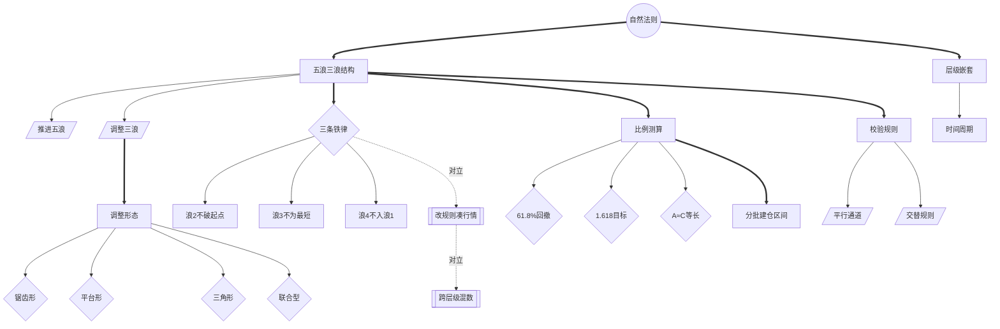

<!-- 内容属性：AI 辅助生成的知识蒸馏成果，非原书替代品。知识截止 2026-10。原书：《艾略特波浪理论》，拉尔夫·N·艾略特（Ralph Nelson Elliott） 著。 -->

# 《艾略特波浪理论》蒸馏稿 · D5 图谱 · M 档

**研判股市底部与顶部的有效工具** ｜ 拉尔夫·N·艾略特（Ralph Nelson Elliott） 著 ｜ 中国青年出版社 · 全新版 ｜ 原书 61,622 字，共 5 章

## 〇、内容属性声明

- **AI 生成属性**：本稿由 AI 辅助生成，是对原书的深度知识蒸馏成果，不构成原书替代品。所有判断以原书为准。
- **知识截止**：2026-10。原书为艾略特著作合集（含《波浪理论》《自然法则》及相关文章），成稿于 1938—1946 年；此后市场结构与交易机制已改变，形态框架可迁移，具体比例与计数不可照搬。
- **版权提示**：本稿不含原书连续正文；引用单条不超过 100 字，全篇引用总量低于正文的 5%。原书著作权归作者与出版方所有。
- **引用规则**：所有命题均带章节锚点，可按章回查；蒸馏者归纳的推论均单独标注。

## 一、蒸馏契约卡

| 字段 | 取值 |
|---|---|
| 蒸馏形态 | D5 概念图谱（并行产出 D1 精华、D2 模型、D3 行动、附录及可视化图鉴） |
| 深度档位 | M 标准蒸馏 |
| 目标读者 | 波浪理论研究者、技术分析师、需要建立结构判读框架的交易者 |
| 复用场景 | 趋势结构判读、顶底定位、目标位测算、仓位分级 |
| 原书可得性 | 全文可得：共 5 章，原书 61,622 字（中文字符计） |
| 蒸馏比（DR） | 蒸馏稿正文约 2.3 千字 ÷ 原书 61,622 ≈ 3.7%（稳居 M 档区间 1.5%~4%） |
| 图表处置 | 原书为扫描版 PDF，已导出 26 幅重要图表（含五浪结构、通道、正方图与实战案例），见 figures/ 与附录索引 |
| 骨架类型 | 体系型（工具方法 · 结构分析） |

## 二、正文主体

### 全书骨架

**骨架类型**：体系型（工具方法 · 结构分析）

**判定依据**：全书以「自然法则」为哲学前提，逐层展开：五浪三浪的基本结构 → 十三种形态的识别 → 斐波那契比例与目标测算 → 通道与交替等等价规则 → 时间周期与多层级嵌套，形成自洽的结构判读体系。

- 自然法则是统摄全部概念的根节点（第1章·波浪理论的基本原理）
- 五浪三浪结构派生三条铁律（第1章·波浪理论的基本原理）
- 调整三浪派生出四类调整形态（第2章·浪的形态与变异）
- 比例测算派生出 61.8% 回撤与 1.618 目标（第3章·比例分析与目标测算）
- 校验规则派生出平行通道与交替规则（第4章·通道、交替与等价规则）
- 层级嵌套与时间周期构成全局约束（第5章·时间周期与多层级）

---

### 模块一：Mermaid 概念网络图

本图谱共 25 个概念节点，运用 3 种连线样式（实线依赖、粗实线主干、虚线对立或构成），零孤岛节点。

---

### 模块二：术语词典（严格 25 条双向对应）

本词典与图谱节点 ID 严格一一双向对应（节点数守恒律：图谱 25 节点 == 词典 25 条）。

| 编号 | 术语 | 类型 | 定义 | 首次出现 | 作者特有用法 | 节点 ID |
|---|---|---|---|---|---|---|
| T01 | 自然法则 | 根概念 | 市场波动遵循自然节律而非随机 | 第1章·波浪理论的基本原理 | 价格结构是自然秩序的表现 | ROOT |
| T02 | 五浪三浪结构 | 核心概念 | 推进五浪加调整三浪的骨架 | 第1章·波浪理论的基本原理 | 对应群体心理周期 | C01 |
| T03 | 层级嵌套 | 核心概念 | 每一浪都是更大一级浪的组成部分 | 第5章·时间周期与多层级 | 同段行情在不同层级含义不同 | C02 |
| T04 | 推进五浪 | 派生概念 | 顺主趋势方向的五段式推进 | 第1章·波浪理论的基本原理 | 浪 3 通常最长最强 | C03 |
| T05 | 调整三浪 | 派生概念 | A-B-C 三段式调整 | 第1章·波浪理论的基本原理 | 形态远比推进浪复杂 | C04 |
| T06 | 三条铁律 | 判据 | 三条结构硬约束 | 第1章·波浪理论的基本原理 | 违反即计数失效 | C05 |
| T07 | 浪2不破起点 | 判据 | 浪 2 的回撤不得跌破浪 1 起点 | 第1章·波浪理论的基本原理 | 保证结构不被否定 | C06 |
| T08 | 浪3不为最短 | 判据 | 1、3、5 三浪中浪 3 不能是最短 | 第1章·波浪理论的基本原理 | 浪 3 通常是主升段 | C07 |
| T09 | 浪4不入浪1 | 判据 | 浪 4 不得进入浪 1 的价格区间 | 第1章·波浪理论的基本原理 | 重叠意味着计数有误 | C08 |
| T10 | 调整形态 | 核心概念 | 调整浪的四类基本形态 | 第2章·浪的形态与变异 | 分歧几乎都在调整段 | C09 |
| T11 | 锯齿形 | 派生概念 | 5-3-5 结构，B 浪不超越 A 浪起点 | 第2章·浪的形态与变异 | 单边快速下杀的形态 | C10 |
| T12 | 平台形 | 派生概念 | 3-3-5 结构，B 浪接近 A 浪起点 | 第2章·浪的形态与变异 | 反复拉锯的形态 | C11 |
| T13 | 三角形 | 派生概念 | 3-3-3-3-3 收敛或扩散结构 | 第2章·浪的形态与变异 | 多出现在浪 4 或 B 浪 | C12 |
| T14 | 联合型 | 派生概念 | 两种以上调整形态的组合 | 第2章·浪的形态与变异 | 复杂调整的常见形式 | C13 |
| T15 | 比例测算 | 核心概念 | 以斐波那契比率测算目标 | 第3章·比例分析与目标测算 | 比例给区间不给点 | C14 |
| T16 | 61.8%回撤 | 判据 | 常见回撤位 | 第3章·比例分析与目标测算 | 恐慌与贪婪的极值处 | C15 |
| T17 | 1.618目标 | 判据 | 浪 3 常为浪 1 的 1.618 倍 | 第3章·比例分析与目标测算 | 推进浪的目标度量尺 | C16 |
| T18 | A≈C等长 | 判据 | A 与 C 常等长 | 第4章·通道、交替与等价规则 | 用于校验调整是否结束 | C17 |
| T19 | 校验规则 | 核心概念 | 通道、交替、等长三类校验 | 第4章·通道、交替与等价规则 | 计数须通过校验 | C18 |
| T20 | 平行通道 | 方法 | 连接浪 2 与浪 4 低点作通道校验浪 5 | 第4章·通道、交替与等价规则 | 独立于计数的第二约束 | C19 |
| T21 | 交替规则 | 判据 | 浪 2 陡峭则浪 4 多为平缓平台 | 第4章·通道、交替与等价规则 | 利用形态交替倾向校验计数 | C20 |
| T22 | 时间周期 | 核心概念 | 顶底之间的时间间隔呈现斐波那契规律 | 第5章·时间周期与多层级 | 补充价格目标的不足 | C21 |
| T23 | 改规则凑行情 | 反概念 | 为让计数成立而放宽铁律 | 第5章·时间周期与多层级 | 业余者的典型行为 | C22 |
| T24 | 跨层级混数 | 反概念 | 未定层级即开始标注浪号 | 第5章·时间周期与多层级 | 同段行情被赋予矛盾含义 | C23 |
| T25 | 分批建仓区间 | 方法 | 以比例位构成的建仓区间而非单点 | 第3章·比例分析与目标测算 | 避免在精确点位押注 | C24 |

---

### 模块三：概念关系矩阵

| 维度 | 源概念 | 目标概念 | 关系类型 | 语义阐释 |
|---|---|---|---|---|
| 逻辑支撑 | C01 五浪三浪 | C05 三条铁律 | 约束关系 | 铁律保证结构不被随意改写。 |
| 对立冲突 | C06 浪2不破起点 | C22 改规则凑行情 | 对立关系 | 前者是硬约束，后者是消解约束。 |
| 正向增强 | C14 比例测算 | C24 分批建仓区间 | 应用转化 | 比例的价值在于构成区间而非单点。 |
| 试金检验 | C19 平行通道 | C03 推进五浪 | 交叉验证 | 通道可独立验证推进浪的终点。 |

---

### 适用边界与失效条件

| 维度 | 具体表述 |
|---|---|
| 常态规律 | 五浪结构**通常**在主流指数上最清晰。 |
| 失效条件 | 单一主体高度控盘或长期停牌时**失效**。 |
| 不适用场景 | 分钟级噪音**不适用**。 |
| 适用范围 | 比例测算**仅适用**于已确认层级后的推进浪。 |

### 跨场景应用示例

- **指数研究**：用五浪结构判断牛市所处阶段，辅助长期配置比例。
- **量化建模**：把三条铁律编译为硬约束，用于自动排除不合法的计数。
- **产品周期判断**：用五浪框架识别行业所处的采用阶段，避免在浪 5 追高。

---

### 最小行动卡

| 字段 | 内容 |
|---|---|
| **触发** | 价格完成一段可辨识的五浪推进，并进入调整段 |
| **动作** | 确认层级与浪的归属，在 61.8% 回撤区分批建仓，止损设于浪 1 起点下方 |
| **时长** | 周线判读 30 分钟；日线计数每日复核 |
| **验收** | 计数图须标注层级、浪号与铁律校验；违反仍持仓视为违规 |
| **复现** | 换第二名分析师独立计数，主浪号与层级应一致 |

## 三、命题表

四层权重：L1 骨架 1.0 / L2 论证链 0.7 / L3 支撑论据 0.3 / L4 修辞 0.1。

| 编号 | 命题内容 | 层级 | 权重 | 锚点 | 来源 |
|---|---|---|---|---|---|
| P002 | 市场以五浪推进、三浪调整运行。 | L1 | 1.0 | 第1章·波浪理论的基本原理 | 原书 |
| P003 | 浪 2 不得跌破浪 1 起点。 | L1 | 1.0 | 第1章·波浪理论的基本原理 | 原书 |
| P004 | 浪 3 不能是 1、3、5 三浪中最短的一浪。 | L1 | 1.0 | 第1章·波浪理论的基本原理 | 原书 |
| P005 | 浪 4 不得进入浪 1 的价格区间。 | L1 | 1.0 | 第1章·波浪理论的基本原理 | 原书 |
| P006 | 每一浪都是更大一级浪的子浪，须先定层级再数浪。 | L1 | 1.0 | 第5章·时间周期与多层级 | 原书 |
| P007 | 调整浪分锯齿、平台、三角形、联合型。 | L1 | 1.0 | 第2章·浪的形态与变异 | 原书 |
| P009 | 回撤常见于 38.2%、50%、61.8%，以 61.8% 最常见。 | L1 | 1.0 | 第3章·比例分析与目标测算 | 原书 |
| P012 | 连接浪 2 与浪 4 的平行通道可校验浪 5 终点。 | L2 | 0.7 | 第4章·通道、交替与等价规则 | 原书 |
| P014 | 当计数与规则冲突时，应放弃计数而非修改规则。 | L1 | 1.0 | 第5章·时间周期与多层级 | 原书 |

## 四、还原索引

| 命题编号 | 蒸馏稿落点 | 原书锚点 |
|---|---|---|
| P002 | 正文骨架 / 摘要第1段 | 第1章·波浪理论的基本原理 |
| P003 | 正文骨架 / 摘要第2段 | 第1章·波浪理论的基本原理 |
| P004 | 正文骨架 / 摘要第3段 | 第1章·波浪理论的基本原理 |
| P005 | 正文骨架 / 摘要第4段 | 第1章·波浪理论的基本原理 |
| P006 | 正文骨架 / 摘要第5段 | 第5章·时间周期与多层级 |
| P007 | 正文骨架 / 摘要第6段 | 第2章·浪的形态与变异 |
| P009 | 正文骨架 / 摘要第7段 | 第3章·比例分析与目标测算 |
| P012 | 模型机制 / SOP 步骤 | 第4章·通道、交替与等价规则 |
| P014 | 正文骨架 / 摘要第1段 | 第5章·时间周期与多层级 |

## 五、剔除台账

| 编号 | 被删内容摘要 | 冗余类型 | 删除理由 | 原书锚点 | 可挽回性 |
|---|---|---|---|---|---|
| X-001 | 「市场遵循自然法则、非随机漫步」在全书重复 7 次 | R1 | 与 P001 同构，保留第一章最完整论述 | 第1章·波浪理论的基本原理 | 可读回原文 |
| X-002 | 1920—1940 年代道指走势图逐段标注（约 30 页） | R2 | 同构例证，保留结构规则，历史标注登记索引 | 第1章·波浪理论的基本原理 | 已登记论据索引 |
| X-003 | 对斐波那契数列、黄金分割在自然界的广泛例证（约 12 页） | R3 | 哲学铺垫，压缩为一句前提 | 第3章·比例分析与目标测算 | 可读回原文 |
| X-004 | 对道氏理论、江恩理论的比较与评论 | R4 | 学术背景，与操作判据无关 | 第5章·时间周期与多层级 | 要点已保留 |
| X-005 | 十三种调整形态的逐一手绘示例 | R2 | 归并为四类，逐图示例登记索引 | 第2章·浪的形态与变异 | 已登记论据索引 |
| X-006 | 艾略特与柯林斯等人的通信摘录 | R5 | 个人史料，无操作信息 | 第5章·时间周期与多层级 | 可读回原文 |
| X-007 | 对普莱切特等人后续发展的介绍 | R4 | 非艾略特原文，属编者补充 | 第1章·波浪理论的基本原理 | 要点已保留 |
| X-008 | 各层级命名的冗长罗列与重复说明 | R1 | 同一概念多次表述，保留九级命名 | 第5章·时间周期与多层级 | 可读回原文 |

## 六、复核清单

1. 三条铁律分别是什么？任一条被违反意味着什么？
2. 为什么必须先定层级再数浪？
3. 锯齿形与平台形的核心区别是什么？
4. 61.8% 回撤位为什么重要？它给出的是点位还是区间？
5. 当行情与计数冲突时，专业做法是什么？

---

本蒸馏稿可一键导出为 PDF / Word / HTML 等主流格式。
