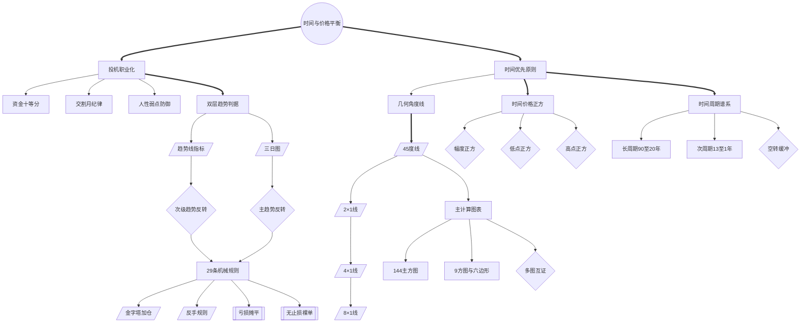

<!-- 内容属性：AI 辅助生成的知识蒸馏成果，非原书替代品。知识截止 2026-10。原书：《江恩商品期货核心教程》，威廉·D·江恩（William D. Gann） 著。 -->

# 《江恩商品期货核心教程》蒸馏稿 · D5 图谱 · M 档

**一部源于江恩权威培训教程的期货交易秘籍** ｜ 威廉·D·江恩（William D. Gann） 著 ｜ 全球证券投资经典译丛 ｜ 原书 171,653 字，共 21 章

## 〇、内容属性声明

- **AI 生成属性**：本稿由 AI 辅助生成，是对原书的深度知识蒸馏成果，不构成原书替代品。所有判断以原书为准。
- **知识截止**：2026-10。原书教程成稿于 1940—1954 年间，基于 CBOT 谷物、棉花与鸡蛋期货的历史行情；此后合约规格、保证金制度与电子撮合机制已发生重大变化，方法框架可迁移，具体点位与比例不可照搬。
- **版权提示**：本稿不含原书连续正文；引用单条不超过 100 字，全篇引用总量低于正文的 5%。原书著作权归作者与出版方所有。
- **引用规则**：所有命题均带章节锚点，可按章回查；蒸馏者归纳的推论均单独标注。

## 一、蒸馏契约卡

| 字段 | 取值 |
|---|---|
| 蒸馏形态 | D5 概念图谱（并行产出 D1 精华、D2 模型、D3 行动、附录及可视化图鉴） |
| 深度档位 | M 标准蒸馏 |
| 目标读者 | 期货交易者、CTA 策略研究员、需要建立机械化风控体系的专业投机者 |
| 复用场景 | 期货交易系统设计、盘中风控执行、盘后复盘自检、交易团队纪律规范 |
| 原书可得性 | 全文可得：共 21 章，原书 171,653 字（中文字符计） |
| 蒸馏比（DR） | 蒸馏稿正文约 5.1 千字 ÷ 原书 171,653 ≈ 3.0%（稳居 M 档区间 1.5%~4%） |
| 图表处置 | 原书 57 幅角度线、主方图与行情走势图已完整提取留存于 figures/ 目录，附录建立专属索引 |
| 骨架类型 | 体系型 + 实践型复合（工具方法 · 交易技术） |

## 二、正文主体

### 全书骨架

**骨架类型**：体系型 + 实践型复合（工具方法 · 交易技术）

**判定依据**：全书自「投机是门职业」的认知前提出发，逐层构建「资金管理 → 图表体系 → 趋势指标 → 止损规则 → 角度线 → 时间正方 → 主计算图表」的层级依赖结构，每一层都是上一层的数学化延伸，最终落到谷物、棉花、鸡蛋三大品种的可执行交易规则。

- 时间与价格平衡是统摄全部概念的根节点（第6章·第1节）
- 投机职业化向下派生资金纪律、交割月纪律与人性弱点防御（第1章·第1节、第2章·第1节）
- 时间优先原则派生几何角度线、时间正方与周期谱系三条支线（第5章—第7章）
- 双层趋势判据向 29 条机械规则提供方向输入（第2章·第2节、第2章·第5节）
- 机械规则向下派生金字塔加仓与反手规则，并与摊平、裸单构成对立（第2章·第5节）
- 主计算图表族以 144 主方图为核，与 9 方图、六边形图构成互证（第12章、第17章）

---

### 模块一：Mermaid 概念网络图

本图谱共 33 个概念节点，运用 3 种连线样式（实线依赖、粗实线主干、虚线对立或构成），零孤岛节点。

---

### 模块二：术语词典（严格 33 条双向对应）

本词典与图谱节点 ID 严格一一双向对应（节点数守恒律：图谱 33 节点 == 词典 33 条）。

| 编号 | 术语 | 类型 | 定义 | 首次出现 | 作者特有用法 | 节点 ID |
|---|---|---|---|---|---|---|
| T01 | 时间与价格平衡 | 根概念 | 价格运动幅度与运行时间达成等比例时的均衡状态 | 第6章·第1节 | 把「涨得太多」替换为「涨得够久」，以时间衡量而非绝对涨幅 | ROOT |
| T02 | 投机职业化 | 核心概念 | 把期货交易视为需长期专业训练、按商业标准经营的职业 | 第1章·第1节 | 否定赌博式交易，要求像律师医生一样投入时间与金钱训练 | C01 |
| T03 | 时间优先原则 | 核心概念 | 在所有变量中时间是第一位的，时间会抑制动能并打破空间与成交量的平衡 | 第7章·第1节 | 空间与成交量重要，但永远不会超过时间的重要性 | C02 |
| T04 | 资金十等分 | 方法 | 将本金分为十份，单次交易风险不超过其中一份 | 第2章·第1节 | 以「能承受几次连续亏损」而非「能赚多少」作为仓位设计的起点 | C03 |
| T05 | 交割月纪律 | 方法 | 绝不在交割月持有或交易对应合约，须提前清仓换月 | 第2章·第4节 | 把合约到期风险视为可完全规避的非市场风险 | C04 |
| T06 | 人性弱点防御 | 派生概念 | 以固定规则隔离期望、恐惧、臆测、固执四种交易心理 | 第1章·第1节 | 认为失败源于人性而非市场，规则是唯一可靠的防御工事 | C05 |
| T07 | 几何角度线 | 核心概念 | 以时间单位为横轴、价格单位为纵轴，按固定比率绘制的射线 | 第5章·第3节 | 把「涨得多快」转化为可比较的斜率，用档位判断强弱 | C06 |
| T08 | 45度线 | 方法 | 每单位时间移动 1 个价格单位的射线，是最重要的移动平均线 | 第5章·第4节 | 价格的平衡线：其上为强势，回踩可买，跌破 1 美分即转弱 | C07 |
| T09 | 2×1线 | 方法 | 每 2 个时间单位移动 1 个价格单位（63.75°）的射线 | 第5章·第4节 | 强势档位，跌破则价格将回落至 45° 线 | C08 |
| T10 | 4×1线 | 方法 | 每 4 个时间单位移动 1 个价格单位（75°）的射线 | 第5章·第4节 | 很强档位，出现在持续加速的行情中 | C09 |
| T11 | 8×1线 | 方法 | 每 8 个时间单位移动 1 个价格单位（82.5°）的射线 | 第5章·第4节 | 最强档位，牛市末期的陡直上涨多沿此线运行 | C10 |
| T12 | 时间价格正方 | 核心概念 | 涨幅点数等于运行日/周/月数时的平衡状态 | 第6章·第1节 | 正方点不是神秘数字，而是速率回归的力学位置 | C11 |
| T13 | 幅度正方 | 判据 | 极限高点与极限低点之差与时间周期成正方 | 第6章·第1节 | 震荡区间越宽，对应的正方时间越长 | C12 |
| T14 | 低点正方 | 判据 | 以极限低点价格为基准，经过同等数量的时间单位成正方 | 第6章·第1节 | 底部价格越低，正方所需时间越短 | C13 |
| T15 | 高点正方 | 判据 | 以极限高点价格为基准，经过同等数量的时间单位成正方 | 第6章·第1节 | 顶部价格越高，正方所需时间越长，转折越重要 | C14 |
| T16 | 时间周期谱系 | 核心概念 | 由长周期、次周期构成的嵌套时间节律体系 | 第7章·第1节 | 要求多周期共振而非单周期决策 | C15 |
| T17 | 长周期 | 派生概念 | 90、84、60、49、45、30、20 年的主要循环 | 第7章·第2节 | 以极限顶底为起点标定，跨越数十年 | C16 |
| T18 | 次周期 | 派生概念 | 13、10、7、5、3、2、1 年的次级循环 | 第7章·第3节 | 13 年（156 个月）在农产品中尤为常见 | C17 |
| T19 | 空转缓冲 | 判据 | 价格超越角度线或中心点 2~2.5 美分为常态，超 3 美分才确认突破 | 第7章·第1节 | 承认机械系统存在误差带，是假突破的过滤器 | C18 |
| T20 | 双层趋势判据 | 核心概念 | 趋势线指标管次级趋势、三日图管主趋势的两级判据结构 | 第2章·第2节 | 禁止用战术信号推翻战略结论 | C19 |
| T21 | 趋势线指标 | 方法 | 随每日更高顶底或更低底逐日移动的趋势线 | 第2章·第2节 | 只看高低点关系，不看收盘价 | C20 |
| T22 | 三日图 | 方法 | 连续三日创更高底/更低底才移动的主趋势指标 | 第2章·第6节 | 主趋势反转的唯一判据，独立于日线绘制 | C21 |
| T23 | 次级趋势反转 | 判据 | 价格穿越最后趋势线顶部或底部 1 美分 | 第2章·第5节 | 只调整战术仓位，不改变战略方向 | C22 |
| T24 | 主趋势反转 | 判据 | 三日图最后底部被跌破或最后顶部被突破 | 第2章·第5节 | 清仓并反手的唯一依据 | C23 |
| T25 | 29条机械规则 | 核心概念 | 覆盖建仓、加仓、止损、反手、离场的编号规则集 | 第2章·第5节 | 每条均给出可量化阈值，使交易可被第三方复现 | C24 |
| T26 | 金字塔加仓 | 方法 | 每顺向固定间隔加一手，止损同步上移的加仓法 | 第2章·第5节 | 加仓资金来自浮盈而非本金，加仓后整体风险不增 | C25 |
| T27 | 反手规则 | 方法 | 止损触发后立即反向建仓，不留观望仓 | 第2章·第5节 | 把止损从「认输」转化为「换方向」 | C26 |
| T28 | 亏损摊平 | 反概念 | 在亏损头寸中加仓以拉低均价的毁灭性行为 | 第2章·第5节 | 被列为破产头号原因，规则13 明令禁止 | C27 |
| T29 | 无止损裸单 | 反概念 | 未挂保护性止损即持有的头寸 | 第2章·第3节 | 视为违规单，任何情况下不可接受 | C28 |
| T30 | 主计算图表 | 核心概念 | 以 144 主方图为核心的时间价格计算工具族 | 第12章·第1节 | 用来把价格放进固定网格，快速读出阻力与时间位 | C29 |
| T31 | 144主方图 | 方法 | 以 12 的平方为基础、9 等分、含 20736 单位的主图表 | 第12章·第1节 | 强阻力位为 1/4、1/3、2/3、3/8、1/2、5/8、3/4、7/8 | C30 |
| T32 | 9方图与六边形 | 方法 | 基于奇数平方扩张与每圈递增 6 的环状图表 | 第17章·第1节 | 与 144 主图互为独立验证，构成多图互证 | C31 |
| T33 | 多图互证 | 判据 | 四张独立构造的图表同时指向同一价位与时间 | 第17章·第1节 | 独立方法给出相同结论，等价于多次独立测量 | C32 |

---

### 模块三：概念关系矩阵

| 维度 | 源概念 | 目标概念 | 关系类型 | 语义阐释 |
|---|---|---|---|---|
| 层次演化 | ROOT 时间与价格平衡 | C11 时间价格正方 | 投影与表达 | 平衡是不可见的第一性原理，正方是其可计算的表达形式。 |
| 逻辑支撑 | C02 时间优先原则 | C15 时间周期谱系 | 支撑关系 | 既然时间第一，就必须建立可标定的时间节律体系。 |
| 对立冲突 | C01 投机职业化 | C27 亏损摊平 | 对立关系 | 职业化要求切断亏损源，摊平是向亏损持续输血。 |
| 对立冲突 | C19 双层趋势判据 | C28 无止损裸单 | 对立关系 | 判据体系的前提是每笔交易都有明确的风险边界。 |
| 正向增强 | C07 45度线 | C11 时间价格正方 | 同构增强 | 45° 线本身就是 1:1 的正方轨迹，跌破即失去平衡。 |
| 正向增强 | C20 趋势线指标 | C21 三日图 | 分层增强 | 次级判据为建仓提供时机，主趋势判据为持仓提供底线。 |
| 因果驱动 | C24 29条机械规则 | C26 金字塔加仓 | 规则内嵌 | 加仓是规则集中的编号动作，不具备独立裁量空间。 |
| 试金检验 | C30 144主方图 | C32 多图互证 | 交叉验证 | 单一图表的信号只是候选，多图交集才构成结论。 |

---

### 适用边界与失效条件

| 维度 | 具体表述 |
|---|---|
| 常态规律 | 本体系各规则**通常**在流动性充裕、连续撮合的标准化期货合约上发挥最大效力。 |
| 典型表现 | 突破关键角度线后**往往**伴随加速运行，而非缓慢爬升。 |
| 环境要求 | **在**合约规格稳定、保证金制度透明、可挂条件单的交易环境**条件下**，参数化止损才可执行。 |
| 失效条件 | 当交易所修改合约规格、实施临时限价或强制平仓规则时，历史点位换算**失效**，须重新标定刻度。 |
| 不适用场景 | 成交极度清淡、日内波幅不足最小变动单位数倍的僵尸合约**不适用**。 |
| 适用范围 | 金字塔加仓**仅适用**于已建立浮盈且突破整理区间的头寸，严禁用于亏损加仓。 |

### 跨场景应用示例

- **CTA 策略开发**：把 29 条规则编译为带阈值的状态机，用历史 tick 数据回测触发频率与滑点敏感度。
- **企业套保决策**：用双层趋势判据区分「战略套保比例」与「战术调整」，避免用短期波动推翻年度套保方案。
- **个人仓位管理**：把「本金十等分」迁移为家庭可投资产的风险预算，单笔风险不超过总资产 1%。

---

### 最小行动卡

| 字段 | 内容 |
|---|---|
| **触发** | 日线趋势线指标与三日图主趋势同向，且价格处于 45° 线之上或回踩 45° 线不破 |
| **动作** | 按资金十等分确定单笔规模，市价入场后立即挂设趋势线底部外 1~3 美分止损；每顺向 5 美分（棉花 40~50 美分）加一手并同步上移止损 |
| **时长** | 盘前图表更新 20 分钟；盘中信号确认与下单 2 分钟；盘后核对三日图与时间窗 15 分钟 |
| **验收** | 交易记录须登记：入场依据的角度线、趋势线底部价位、止损价、加仓阶梯、对应时间周期天数；无止损记录视为违规单 |
| **复现** | 换第二名交易员依同一图表与规则复核，止损位与加仓位误差不超过 1 个最小变动单位 |

## 三、命题表

四层权重：L1 骨架 1.0 / L2 论证链 0.7 / L3 支撑论据 0.3 / L4 修辞 0.1。

| 编号 | 命题内容 | 层级 | 权重 | 锚点 | 来源 |
|---|---|---|---|---|---|
| P001 | 投机是需专业训练的职业，失败源于人性弱点而非市场。 | L1 | 1.0 | 第1章·第1节 | 原书 |
| P002 | 趋势向上创更高顶底，向下创更低顶底。 | L1 | 1.0 | 第1章·第1节 | 原书 |
| P003 | 长期盘整后破前低预示创新低，破前高预示创新高。 | L1 | 1.0 | 第1章·第1节 | 原书 |
| P004 | 趋势向上不因价高不敢买，向下不因价低不敢卖。 | L1 | 1.0 | 第1章·第1节 | 原书 |
| P005 | 须制年、月、周、日四级高低点图表，年图溯 5~20 年。 | L2 | 0.7 | 第1章·第1节 | 原书 |
| P006 | 交易前必设止损，止损同时保护本金与既得利润。 | L2 | 0.7 | 第1章·第1节 | 原书 |
| P007 | 急涨急跌后必出现更快的反向修正，须以周、日图捕捉。 | L2 | 0.7 | 第1章·第1节 | 原书 |
| P008 | 本金十等分，单次风险不超十分之一，按价格区间匹配保证金。 | L1 | 1.0 | 第2章·第1节 | 原书 |
| P009 | 趋势线随更高顶底上移、随更低底下移，只看高低点不看收盘。 | L1 | 1.0 | 第2章·第2节 | 原书 |
| P010 | 止损设于趋势线底部下或顶部上 1~3 美分。 | L1 | 1.0 | 第2章·第3节 | 原书 |
| P011 | 三日图只依更高底与更低顶构建，是主趋势的唯一判据。 | L2 | 0.7 | 第2章·第6节 | 原书 |
| P012 | 29 条规则覆盖双顶底、第四次突破、7~10 日、金字塔与反手。 | L2 | 0.7 | 第2章·第5节 | 原书 |
| P013 | 小麦 50~70 美分时每手 5000 蒲式耳需 750 美元，可承受十次连亏。 | L3 | 0.3 | 第2章·第1节 | 原书 |
| P014 | 日线周期太短，须以两日图捕捉快速行情中的反转信号。 | L2 | 0.7 | 第3章·两日运行图表反转 | 原书 |
| P015 | 规则1：两日图底部未破则主趋势向上，顶部未越则向下。 | L1 | 1.0 | 第4章·第1节 | 原书 |
| P016 | 规则2：价格近极限顶底时只记 1 日变化，破 1 日波动即转势。 | L1 | 1.0 | 第4章·第1节 | 原书 |
| P017 | 规则3：止损设于两日图底部下或顶部上 1~2 美分。 | L1 | 1.0 | 第4章·第1节 | 原书 |
| P018 | 规则4：第四次到达同一水平应卖空，第四次下跌不应买进。 | L1 | 1.0 | 第4章·第1节 | 原书 |
| P019 | 规则5：50% 跌幅与最高卖价一半是最安全买点，反之是最安全卖点。 | L1 | 1.0 | 第4章·第1节 | 原书 |
| P020 | 规则6：主趋势向上时，10~14 天的回调期间买入较安全。 | L2 | 0.7 | 第4章·第1节 | 原书 |
| P021 | 几何角度线精确测量时间、价格与空间，45° 线最重要。 | L1 | 1.0 | 第5章·第3节 | 原书 |
| P022 | 价格在 45° 线之上为强势，回踩可买，跌破 1 美分即转弱。 | L1 | 1.0 | 第5章·第4节 | 原书 |
| P023 | 强弱序列：8×1（82.5°）>4×1（75°）>2×1（63.75°）>45°。 | L1 | 1.0 | 第5章·第4节 | 原书 |
| P024 | 熊市侧序列：45° 之下依次 2×1（26.25°）、4×1（15°）、8×1（7.5°）。 | L1 | 1.0 | 第5章·第5节 | 原书 |
| P025 | 任一角度线被跌破，价格必跌向更低一条。 | L1 | 1.0 | 第5章·第4节 | 原书 |
| P026 | 顶与底同时绘制的角度线，其交点为趋势变化要位。 | L1 | 1.0 | 第5章·第7节 | 原书 |
| P027 | 自「0」位绘制的 45° 线在时间价格成正方时提供关键支撑。 | L2 | 0.7 | 第5章·第7节 | 原书 |
| P028 | 双重或三重顶底各自绘制的角度线相交处，是趋势变化的强信号。 | L2 | 0.7 | 第5章·第7节 | 原书 |
| P029 | 时间与价格成正方（幅度、低点、高点三种）时趋势失去平衡。 | L1 | 1.0 | 第6章·第1节 | 原书 |
| P030 | 短期变化在第 7、10、14、20、21、28、30 天；中期在 30~360 天。 | L2 | 0.7 | 第7章·第1节 | 原书 |
| P031 | 长周期 90/84/60/49/45/30/20 年；次周期 13/10/7/5/3/2/1 年。 | L2 | 0.7 | 第7章·第1节 | 原书 |
| P032 | 24 美分循环：24、48、72、144 美分是重要阻力间隔。 | L2 | 0.7 | 第8章·价格阻力水平 | 原书 |
| P033 | 棉花每 100 包至少 1500 美元本金，单次止损不超 30 美分。 | L1 | 1.0 | 第9章·第1节 | 原书 |
| P034 | 棉花趋势线止损 20~30 美分，活跃市用 30 美分价差。 | L1 | 1.0 | 第9章·第3节 | 原书 |
| P035 | 棉花 29 条规则与谷物同构，参数按品种换算。 | L1 | 1.0 | 第9章·第4节 | 原书 |
| P036 | 棉花须另制 20 美分空间图表与小时图表。 | L2 | 0.7 | 第9章·第3节 | 原书 |
| P037 | 三日图波动超 10~30 美分是主趋势变化的可靠信号。 | L2 | 0.7 | 第9章·第4节 | 原书 |
| P038 | 棉花 45° 线按每日 10 美分、每周 15 美分、每月 20 美分绘制。 | L1 | 1.0 | 第10章·第4节 | 原书 |
| P039 | 棉花强弱序列按 10/20/40/80 美分递增，跌破即降档。 | L1 | 1.0 | 第10章·第4节 | 原书 |
| P040 | 牛市中棉花常运行 3~7 周，周六收盘价转低是首个警讯。 | L1 | 1.0 | 第10章·第3节 | 原书 |
| P041 | 信号日：强势开盘创新高后回落、收于低位或低于中点，趋势至少临时反转。 | L1 | 1.0 | 第10章·第3节 | 原书 |
| P042 | 快速市中回调满 3 天且弱势收盘，是次级趋势改变的信号。 | L1 | 1.0 | 第10章·第3节 | 原书 |
| P043 | 棉花日图比例 1/8 英寸 = 10 美分，周图 15 美分，月图 20 美分。 | L2 | 0.7 | 第10章·第2节 | 原书 |
| P044 | 须观察自顶底起算的第 84~90 个日历日与 120 日周期。 | L2 | 0.7 | 第10章·第3节 | 原书 |
| P045 | 鸡蛋 360° 主图按每 15° 划分，每格代表 288 个时间或价格单位。 | L1 | 1.0 | 第11章·第2节 | 原书 |
| P046 | 价格顶点有 9 个数学特征，几何角度线最重要，因以价格测时间。 | L1 | 1.0 | 第11章·第4节 | 原书 |
| P047 | 144 与 12 方图给出自然阻力位，重要顶底落在 1/4、1/3、1/2、3/4 上。 | L1 | 1.0 | 第11章·第5节 | 原书 |
| P048 | 时间与价格成正方决定顶底，须从极限高低点起算。 | L1 | 1.0 | 第11章·第5节 | 原书 |
| P049 | 主趋势未明确改变前一直等待，绝不猜测，入场必设止损。 | L1 | 1.0 | 第11章·第6节 | 原书 |
| P050 | 鸡蛋案例：5 条不同起点角度线交汇于同一价位，构成强压力区。 | L2 | 0.7 | 第11章·第1节 | 原书 |
| P051 | 鸡蛋以 30 点/单位在 2~16 平方区间运行，最小变动 5 点。 | L2 | 0.7 | 第11章·第1节 | 原书 |
| P052 | 52 周时间价格正方形用于标定年内转折，关注第 13、26、39 周。 | L2 | 0.7 | 第11章·第4节 | 原书 |
| P053 | 144 主方图以 12 的平方为基、9 等分、含 20736 单位。 | L1 | 1.0 | 第12章·第1节 | 原书 |
| P054 | 144 方图强阻力为 1/4、1/3、2/3、3/8、1/2、5/8、3/4、7/8。 | L1 | 1.0 | 第12章·第1节 | 原书 |
| P055 | 主计算表刻度 0~144，价格超 144 则减 144 后重复刻度。 | L1 | 1.0 | 第13章·主计算表在5月大豆期货的应用 | 原书 |
| P056 | 5 月大豆高点 436¾ 位于第 4 个方图的 4¾ 处，幅度 392¾ 含 2 个 144。 | L2 | 0.7 | 第13章·主计算表在5月大豆期货的应用 | 原书 |
| P057 | 周周期上叠加主计算图，可把日线噪音过滤为周级趋势判定。 | L1 | 1.0 | 第14章·第2节 | 原书 |
| P058 | 5 月大豆的现货价与期货价须分别标定时间周期与阻力位。 | L1 | 1.0 | 第15章·第1节 | 原书 |
| P059 | 5 月大豆的日、周、月行情须各自对照 45° 线与 2×1 线的穿越。 | L2 | 0.7 | 第15章·第3节 | 原书 |
| P060 | 67 方图用于标定 5 月大豆日、周、月三个时间周期的转折。 | L2 | 0.7 | 第16章·5月大豆期货日、周和月时间周期的67方图 | 原书 |
| P061 | 12 主图、9 方图、六边形图与 360° 圆图互证，顶底常在角度重合。 | L1 | 1.0 | 第17章·第1节 | 原书 |
| P062 | 六边形每圈递增 6，第 7 圈 127、第 8 圈 169 为关键转折。 | L2 | 0.7 | 第17章·第1节 | 原书 |
| P063 | 12 主图的次级重心与对冲位是价格最顽强的阻力，第 8、9 区为死亡区。 | L2 | 0.7 | 第17章·第1节 | 原书 |
| P064 | 主时价图表把时间与价格放在同一网格，读出任一时点的均衡价位。 | L2 | 0.7 | 第18章·主时价图表 | 原书 |
| P065 | 0~360° 时价循环图用于标定完整循环内的转折角度。 | L2 | 0.7 | 第19章·0～360°的时价循环图表 | 原书 |
| P066 | 咖啡合约案例显示价格转折与自然周期角度存在对应关系。 | L2 | 0.7 | 第20章·第1节 | 原书 |
| P067 | 供需信件表明供给短缺是牛市的基本面燃料，但入场仍须等价格信号。 | L3 | 0.3 | 第21章·关于市场供需的信件摘要 | 原书 |

## 四、还原索引

| 命题编号 | 蒸馏稿落点 | 原书锚点 |
|---|---|---|
| P001 | 正文骨架 / 摘要第1段 | 第1章·第1节 |
| P002 | 正文骨架 / 摘要第2段 | 第1章·第1节 |
| P003 | 正文骨架 / 摘要第3段 | 第1章·第1节 |
| P004 | 正文骨架 / 摘要第4段 | 第1章·第1节 |
| P005 | 模型机制 / SOP 步骤 | 第1章·第1节 |
| P006 | 模型机制 / SOP 步骤 | 第1章·第1节 |
| P007 | 模型机制 / SOP 步骤 | 第1章·第1节 |
| P008 | 正文骨架 / 摘要第8段 | 第2章·第1节 |
| P009 | 正文骨架 / 摘要第1段 | 第2章·第2节 |
| P010 | 正文骨架 / 摘要第2段 | 第2章·第3节 |
| P011 | 模型机制 / SOP 步骤 | 第2章·第6节 |
| P012 | 模型机制 / SOP 步骤 | 第2章·第5节 |
| P013 | 案例与论据 | 第2章·第1节 |
| P014 | 模型机制 / SOP 步骤 | 第3章·两日运行图表反转 |
| P015 | 正文骨架 / 摘要第7段 | 第4章·第1节 |
| P016 | 正文骨架 / 摘要第8段 | 第4章·第1节 |
| P017 | 正文骨架 / 摘要第1段 | 第4章·第1节 |
| P018 | 正文骨架 / 摘要第2段 | 第4章·第1节 |
| P019 | 正文骨架 / 摘要第3段 | 第4章·第1节 |
| P020 | 模型机制 / SOP 步骤 | 第4章·第1节 |
| P021 | 正文骨架 / 摘要第5段 | 第5章·第3节 |
| P022 | 正文骨架 / 摘要第6段 | 第5章·第4节 |
| P023 | 正文骨架 / 摘要第7段 | 第5章·第4节 |
| P024 | 正文骨架 / 摘要第8段 | 第5章·第5节 |
| P025 | 正文骨架 / 摘要第1段 | 第5章·第4节 |
| P026 | 正文骨架 / 摘要第2段 | 第5章·第7节 |
| P027 | 模型机制 / SOP 步骤 | 第5章·第7节 |
| P028 | 模型机制 / SOP 步骤 | 第5章·第7节 |
| P029 | 正文骨架 / 摘要第5段 | 第6章·第1节 |
| P030 | 模型机制 / SOP 步骤 | 第7章·第1节 |
| P031 | 模型机制 / SOP 步骤 | 第7章·第1节 |
| P032 | 模型机制 / SOP 步骤 | 第8章·价格阻力水平 |
| P033 | 正文骨架 / 摘要第1段 | 第9章·第1节 |
| P034 | 正文骨架 / 摘要第2段 | 第9章·第3节 |
| P035 | 正文骨架 / 摘要第3段 | 第9章·第4节 |
| P036 | 模型机制 / SOP 步骤 | 第9章·第3节 |
| P037 | 模型机制 / SOP 步骤 | 第9章·第4节 |
| P038 | 正文骨架 / 摘要第6段 | 第10章·第4节 |
| P039 | 正文骨架 / 摘要第7段 | 第10章·第4节 |
| P040 | 正文骨架 / 摘要第8段 | 第10章·第3节 |
| P041 | 正文骨架 / 摘要第1段 | 第10章·第3节 |
| P042 | 正文骨架 / 摘要第2段 | 第10章·第3节 |
| P043 | 模型机制 / SOP 步骤 | 第10章·第2节 |
| P044 | 模型机制 / SOP 步骤 | 第10章·第3节 |
| P045 | 正文骨架 / 摘要第5段 | 第11章·第2节 |
| P046 | 正文骨架 / 摘要第6段 | 第11章·第4节 |
| P047 | 正文骨架 / 摘要第7段 | 第11章·第5节 |
| P048 | 正文骨架 / 摘要第8段 | 第11章·第5节 |
| P049 | 正文骨架 / 摘要第1段 | 第11章·第6节 |
| P050 | 模型机制 / SOP 步骤 | 第11章·第1节 |
| P051 | 模型机制 / SOP 步骤 | 第11章·第1节 |
| P052 | 模型机制 / SOP 步骤 | 第11章·第4节 |
| P053 | 正文骨架 / 摘要第5段 | 第12章·第1节 |
| P054 | 正文骨架 / 摘要第6段 | 第12章·第1节 |
| P055 | 正文骨架 / 摘要第7段 | 第13章·主计算表在5月大豆期货的应用 |
| P056 | 模型机制 / SOP 步骤 | 第13章·主计算表在5月大豆期货的应用 |
| P057 | 正文骨架 / 摘要第1段 | 第14章·第2节 |
| P058 | 正文骨架 / 摘要第2段 | 第15章·第1节 |
| P059 | 模型机制 / SOP 步骤 | 第15章·第3节 |
| P060 | 模型机制 / SOP 步骤 | 第16章·5月大豆期货日、周和月时间周期的67方图 |
| P061 | 正文骨架 / 摘要第5段 | 第17章·第1节 |
| P062 | 模型机制 / SOP 步骤 | 第17章·第1节 |
| P063 | 模型机制 / SOP 步骤 | 第17章·第1节 |
| P064 | 模型机制 / SOP 步骤 | 第18章·主时价图表 |
| P065 | 模型机制 / SOP 步骤 | 第19章·0～360°的时价循环图表 |
| P066 | 模型机制 / SOP 步骤 | 第20章·第1节 |
| P067 | 案例与论据 | 第21章·关于市场供需的信件摘要 |

## 五、剔除台账

| 编号 | 被删内容摘要 | 冗余类型 | 删除理由 | 原书锚点 | 可挽回性 |
|---|---|---|---|---|---|
| X-001 | 「投机是门职业、失败源于人性」在第一章、第二章、第九章、第十一章重复 6 次 | R1 | 与 P001、P005 同构，保留第一章最具代表性的论述，其余合并提纯 | 第1章·第1节、第2章·第1节、第9章·第1节 | 可读回原文 |
| X-002 | 各品种保证金金额的逐年罗列（1910—1950 年代小麦、玉米、棉花保证金变动表） | R2 | 数据已被现代保证金制度取代，提炼其「按价格区间匹配保证金」的原则 | 第2章·第1节、第9章·第1节 | 已登记论据索引 |
| X-003 | 爱默生、毕达哥拉斯、《圣经》引言与「数字不说谎」等修辞段落约 20 处 | R3 | 属于文化衬托，不含操作判据，剔除后不影响任何规则 | 第5章·第1节、第12章·第1节 | 可读回原文 |
| X-004 | 1917 年美国参战、战时价格管制、CBOT 交易时段变迁等时代背景叙述 | R4 | 特定历史背景，与通用交易机制无关，压缩为一句背景注记 | 第1章·第1节、第7章·第1节 | 要点已保留 |
| X-005 | 行星经度、黄道十二宫与价格换算的完整推演（第8章、第20章） | R4 | 属作者个人方法论延伸，缺乏独立可验证性；保留「24 美分循环」等可计算部分，占星推演压缩为一句注记 | 第8章·价格阻力水平、第20章·第1节 | 可读回原文 |
| X-006 | 鸡蛋期货逐月高低点流水（1918—1949 年共 31 年、约 60 组数据） | R2 | 同构例证，提炼其「以年度顶底标定时间周期」的方法，原始数据保留在 figures/ 图表中 | 第11章·第2节 | 已登记论据索引 |
| X-007 | 作者自述 52 年从业经历、向读者推介后续课程与通讯服务等自我指涉内容 | R5 | 个人宣传，无现代通用信息增量 | 第1章·第1节、第11章·第1节 | 可读回原文 |
| X-008 | 5 月大豆、5 月黑麦逐日行情流水与电报原文（约 40 页） | R2 | 逐日数据繁复，提炼其关键的顶底与角度线交点，原始图形留存 figures/ 目录 | 第1章·第3节、第8章·价格阻力水平 | 已登记论据索引 |

## 六、复核清单

1. 能否不看书说出趋势线指标与三日图的分工，以及各自被击穿时应对应的仓位动作？
2. 能否说明「第三底买入风险不超过 1 美分」的理由，以及破位后为何必须反手而非观望？
3. 能否写出 45°、2×1、4×1、8×1 四个档位的角度值与跌破后的传导顺序？
4. 能否解释「时间与价格成正方」的三种类型，并各举一个可计算的例子？
5. 能否列出至少 6 个「12」倍数法则中的关键月数，并说明空转缓冲的作用？

---

本蒸馏稿可一键导出为 PDF / Word / HTML 等主流格式。
