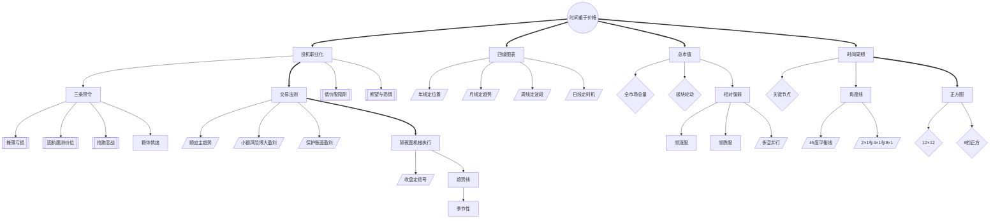

<!-- 内容属性：AI 辅助生成的知识蒸馏成果，非原书替代品。知识截止 2026-10。原书：《江恩股票投资圣经》，威廉·D·江恩（William D. Gann） 著。 -->

# 《江恩股票投资圣经》蒸馏稿 · D5 图谱 · M 档

**一部源于江恩权威培训教程的股市投资秘籍** ｜ 威廉·D·江恩（William D. Gann） 著 ｜ 全球证券投资经典译丛 ｜ 原书 323,219 字，共 5 章

## 〇、内容属性声明

- **AI 生成属性**：本稿由 AI 辅助生成，是对原书的深度知识蒸馏成果，不构成原书替代品。所有判断以原书为准。
- **知识截止**：2026-10。原书为江恩股票培训教程（Stock Market Course），成稿于 1930—1940 年代；此后交易机制、信息披露与指数编制已根本改变，方法框架可迁移，具体点位与比例不可照搬。
- **版权提示**：本稿不含原书连续正文；引用单条不超过 100 字，全篇引用总量低于正文的 5%。原书著作权归作者与出版方所有。
- **引用规则**：所有命题均带章节锚点，可按章回查；蒸馏者归纳的推论均单独标注。

## 一、蒸馏契约卡

| 字段 | 取值 |
|---|---|
| 蒸馏形态 | D5 概念图谱（并行产出 D1 精华、D2 模型、D3 行动、附录及可视化图鉴） |
| 深度档位 | M 标准蒸馏 |
| 目标读者 | 希望系统掌握江恩股票交易体系的交易者、策略研究员与教学者 |
| 复用场景 | 交易系统搭建、选股与择时、时间周期研判、机械交易执行 |
| 原书可得性 | 全文可得：共 5 章，原书 323,219 字（中文字符计） |
| 蒸馏比（DR） | 蒸馏稿正文约 6.4 千字 ÷ 原书 323,219 ≈ 2.0%（稳居 M 档区间 1.5%~4%） |
| 图表处置 | 原书 60 幅主图、正方图、角度线与总市值图已提取留存于 figures/ 目录，附录建立专属索引 |
| 骨架类型 | 体系型（工具方法 · 交易教程） |

## 二、正文主体

### 全书骨架

**骨架类型**：体系型（工具方法 · 交易教程）

**判定依据**：五章构成完整教程：第一章确立投机职业化与交易法则，第二章进入预测方法（时间周期、趋势线、角度、正方图），第三章给出隔夜图机械交易法，第四章专论趋势线，第五章以季节性变化收束，形成「认知—预测—执行—验证」的闭环。

- 时间重于价格是统摄全部概念的根节点（第2章·预测股市行情的时间周期法则）
- 投机职业化派生三条禁令与交易法则（第1章·基本的交易法则）
- 四级图表派生年线定位置至日线定时机（第1章·需要保留哪些走势图）
- 总市值派生出板块轮动与相对强弱（第1章·总市值）
- 时间周期派生出关键节点、角度线与正方图（第2章）
- 隔夜图、趋势线与季节性构成执行与验证层（第3章至第5章）

---

### 模块一：Mermaid 概念网络图

本图谱共 37 个概念节点，运用 3 种连线样式（实线依赖、粗实线主干、虚线对立或构成），零孤岛节点。

---

### 模块二：术语词典（严格 37 条双向对应）

本词典与图谱节点 ID 严格一一双向对应（节点数守恒律：图谱 37 节点 == 词典 37 条）。

| 编号 | 术语 | 类型 | 定义 | 首次出现 | 作者特有用法 | 节点 ID |
|---|---|---|---|---|---|---|
| T01 | 时间重于价格 | 根概念 | 时间是第一变量，会打破空间与成交量的平衡 | 第2章·预测股市行情的时间周期法则 | 把「走了多久」置于「走了多远」之上 | ROOT |
| T02 | 投机职业化 | 核心概念 | 把投机当职业经营，按商业标准管理风险 | 第1章·投机是个能赚大钱的行当 | 以职业标准替代赌博心态 | C01 |
| T03 | 三条禁令 | 核心概念 | 不摊平、不固执、不抢跑恋战 | 第1章·基本的交易法则 | 用禁令直接切断致命行为路径 | C02 |
| T04 | 摊薄亏损 | 反概念 | 在亏损头寸加仓以拉低均价 | 第1章·永远也不要去摊薄每股的平均亏损额 | 被列为三条禁令之首 | C03 |
| T05 | 固执臆测价位 | 反概念 | 坚持自己计算或猜测的价位而无视市场证据 | 第1章·固执的想法和瞎猜的价位 | 把计算当事实的典型错误 | C04 |
| T06 | 抢跑恋战 | 反概念 | 进场太早或离场太晚 | 第1章·进场不要太早，离场不要太晚 | 时机错误比方向错误更常见 | C05 |
| T07 | 交易法则 | 核心概念 | 顺应趋势、小额风险、保护盈利的规则集 | 第1章·交易法则 | 把判断前置为规则 | C06 |
| T08 | 顺应主趋势 | 方法 | 只在主趋势方向开仓 | 第1章·顺应主趋势进行操作 | 逆势者只能赚小钱亏大钱 | C07 |
| T09 | 小额风险博大盈利 | 方法 | 单次风险有限而盈利不设上限 | 第1章·以小额风险去博取大笔盈利 | 非对称期望值的核心 | C08 |
| T10 | 保护账面盈利 | 方法 | 浮盈后上移止损，不让盈利转亏 | 第1章·如何保住你的账面盈利 | 把纸面富贵固化为防线 | C09 |
| T11 | 四级图表 | 核心概念 | 年、月、周、日各承担一类判断 | 第1章·需要保留哪些走势图 | 禁止越级推翻结论 | C10 |
| T12 | 年线定位置 | 方法 | 以年线判断历史新高区或底部区 | 第1章·年高低点图 | 回答历史位置问题 | C11 |
| T13 | 月线定趋势 | 方法 | 以月线确认主趋势 | 第1章·月高低点图 | 主趋势的判据 | C12 |
| T14 | 周线定波段 | 方法 | 以周线定位波段与止损基准 | 第1章·周高低点图 | 止损设置的参照 | C13 |
| T15 | 日线定时机 | 方法 | 以日线捕捉入场时机 | 第1章·需要保留哪些走势图 | 信号有效期最短 | C14 |
| T16 | 总市值 | 核心概念 | 全部上市公司股价与股本之积的总和 | 第1章·总市值 | 比指数更难被少数权重股扭曲 | C15 |
| T17 | 全市场总量 | 判据 | 全市场总市值的趋势方向 | 第1章·纽约证券交易所中全体上市公司股票的总市值 | 判断资金流入或流出 | C16 |
| T18 | 板块轮动 | 判据 | 板块总市值的相对变化 | 第1章·全体股票与各个板块的总市值 | 揭示资金在板块间的迁移 | C17 |
| T19 | 相对强弱 | 核心概念 | 个股相对大盘的强弱排名 | 第1章·股票何时走势最强 | 抗跌加率先突破者为最强 | C18 |
| T20 | 领涨股 | 派生概念 | 大盘下跌抗跌、企稳率先突破的个股 | 第1章·为什么在新高做多买入 | 下一轮行情的先锋 | C19 |
| T21 | 领跌股 | 派生概念 | 大盘上涨滞涨、回调即破位的个股 | 第1章·为什么在新低做空卖出 | 最佳的做空标的 | C20 |
| T22 | 时间周期 | 核心概念 | 从顶底起算的关键时间节点 | 第2章·预测股市行情的时间周期法则 | 节点只给窗口不给日期 | C21 |
| T23 | 关键节点 | 判据 | 30/60/90/120/135/180/225/270/315/360 | 第2章·预测股市行情的时间周期法则 | 时间到而价未创新高即转折候选 | C22 |
| T24 | 角度线 | 核心概念 | 把时间与价格放进同一坐标系的射线 | 第2章·为什么平面几何中的角对股价有影响力 | 以斜率衡量趋势强度 | C23 |
| T25 | 45度平衡线 | 方法 | 每单位时间移动一个价格单位的射线 | 第2章·如何运用平面几何中的角 | 价格的平衡线，其上为强势 | C24 |
| T26 | 强弱档位 | 判据 | 2×1、4×1、8×1 构成的递增强度序列 | 第2章·如何运用平面几何中的角 | 跌破一条即跌向更低一条 | C25 |
| T27 | 正方图 | 核心概念 | 把价格与时间量化到固定网格的图表 | 第2章·主图之12×12的正方图 | 用来读出阻力与转折位 | C26 |
| T28 | 12×12正方 | 方法 | 边长为 12 的正方形共 144 格 | 第2章·主图之12×12的正方图 | 月线级别的重要周期 | C27 |
| T29 | 9的正方 | 方法 | 以 9 为基数的正方图，每级递增 81 | 第2章·9的正方图 | 用于标定短期转折 | C28 |
| T30 | 隔夜图 | 方法 | 只记录收盘与次日开盘关系的机械交易法 | 第3章·隔夜图交易法 | 把决策完全移出盘中 | C29 |
| T31 | 收盘定信号 | 判据 | 以收盘价相对前一日区间的位置生成信号 | 第3章·隔夜图交易法 | 收盘价信息含量最高 | C30 |
| T32 | 趋势线 | 方法 | 连接重要低点或高点形成的直线 | 第4章·我的预测方法的基础——趋势线 | 跌破上升趋势线为转弱第一信号 | C31 |
| T33 | 季节性 | 派生概念 | 不同月份的市场节奏差异 | 第5章·股票的季节性变化 | 只作背景概率不作独立信号 | C32 |
| T34 | 低价股陷阱 | 反概念 | 因价格低廉而买入缺乏成长性的个股 | 第1章·令人失望的低价股 | 价格低常因缺乏成长与资金关注 | C33 |
| T35 | 期望与恐惧 | 反概念 | 交易者最大的两个情绪敌人 | 第1章·期望与恐惧的情绪 | 两者都会扭曲对趋势的判断 | C34 |
| T36 | 群体情绪 | 派生概念 | 操纵受限后仍可被利用的集体心理 | 第1章·轻易操纵股市的日子已经过去 | 规则变了，人性未变 | C35 |
| T37 | 多空并行 | 方法 | 同一时间对不同板块分别买入与卖出 | 第1章·在同一时间，对不同板块的个股分别进行买入和卖出 | 剥离大盘方向，专注相对价值 | C36 |

---

### 模块三：概念关系矩阵

| 维度 | 源概念 | 目标概念 | 关系类型 | 语义阐释 |
|---|---|---|---|---|
| 逻辑支撑 | C01 投机职业化 | C03 三条禁令 | 结构包含 | 禁令是职业化的最低门槛。 |
| 对立冲突 | C03 三条禁令 | C04 摊薄亏损 | 对立关系 | 摊平被列为第一禁令。 |
| 对立冲突 | C07 顺应主趋势 | C06 抢跑恋战 | 对立关系 | 抢跑本质是无视趋势未确认。 |
| 正向增强 | C16 总市值 | C19 相对强弱 | 分工互补 | 总量定方向，强弱定标的。 |
| 因果驱动 | C22 时间周期 | C23 关键节点 | 具体化 | 周期通过节点落到日历上。 |
| 同构增强 | C24 角度线 | C27 正方图 | 同一坐标系 | 两者都把时间与价格放入同一网格。 |
| 试金检验 | C30 隔夜图 | C31 趋势线 | 交叉验证 | 机械信号与趋势判据互相印证。 |
| 边界约束 | C33 季节性 | C22 时间周期 | 权重调整 | 季节性只调整周期窗口的权重。 |

---

### 适用边界与失效条件

| 维度 | 具体表述 |
|---|---|
| 常态规律 | 四级图表与总市值图**通常**在成熟市场中最有效。 |
| 环境要求 | **在**价格连续、成分稳定**条件下**历史阻力位才可比。 |
| 失效条件 | 指数成分大幅调整或制度断裂时，历史位**失效**。 |
| 不适用场景 | 流动性极差、单笔即可影响价格的小盘股**不适用**。 |
| 适用范围 | 隔夜图法**仅适用**于可稳定取得收盘与开盘价的市场。 |

### 跨场景应用示例

- **量化策略**：把隔夜图规则编译为收盘后运行的信号生成器，回测不同区间阈值。
- **资产配置**：用总市值与板块总市值判断资金流向，指导大类与行业配置。
- **个人交易**：把「收盘后决策」迁移为固定复盘时段，切断盘中情绪干扰。

---

### 最小行动卡

| 字段 | 内容 |
|---|---|
| **触发** | 总市值图向上、个股相对强弱居前、时间周期到达关键节点 |
| **动作** | 在收盘后按隔夜图规则确定次日买卖，止损设于反向边界外，单笔风险不超本金十分之一 |
| **时长** | 收盘后图表更新与决策 30 分钟；每周总市值复核一次；每月时间周期校准 |
| **验收** | 记录须写明总市值方向、相对强弱排名、时间周期计数、隔夜图信号与止损价；无止损视为违规 |
| **复现** | 换第二名交易员依同一隔夜图规则执行，买卖信号应完全一致 |

## 三、命题表

四层权重：L1 骨架 1.0 / L2 论证链 0.7 / L3 支撑论据 0.3 / L4 修辞 0.1。

| 编号 | 命题内容 | 层级 | 权重 | 锚点 | 来源 |
|---|---|---|---|---|---|
| P001 | 投机能赚大钱，前提是把它当职业经营。 | L2 | 0.7 | 第1章·投机是个能赚大钱的行当 | 原书 |
| P002 | 三条禁令：不摊薄亏损、不固执臆测价位、不抢跑恋战。 | L1 | 1.0 | 第1章·基本的交易法则 | 原书 |
| P003 | 严禁摊薄每股平均亏损额，此为致命错误之首。 | L1 | 1.0 | 第1章·永远也不要去摊薄每股的平均亏损额 | 原书 |
| P004 | 只在主趋势方向开仓，逆势者只能赚小钱亏大钱。 | L1 | 1.0 | 第1章·顺应主趋势进行操作 | 原书 |
| P005 | 以小额风险博取大笔盈利，盈利不设上限。 | L1 | 1.0 | 第1章·以小额风险去博取大笔盈利 | 原书 |
| P006 | 浮盈后须上移止损，绝不让既得利润变为亏损。 | L1 | 1.0 | 第1章·如何保住你的账面盈利 | 原书 |
| P007 | 止损设于反向边界外 1~3 点。 | L2 | 0.7 | 第1章·止损单的价位应设在哪里 | 原书 |
| P008 | 最佳买点为双底或突破前高后的回抽。 | L1 | 1.0 | 第1章·最佳买入点位 | 原书 |
| P009 | 最佳卖点为双顶或跌破前低后的反弹。 | L1 | 1.0 | 第1章·最佳卖出点位 | 原书 |
| P010 | 区间 50% 价位是重要的买卖参考。 | L2 | 0.7 | 第1章·克莱斯勒汽车 | 原书 |
| P011 | 须保留年、月、周、日四级高低点图，各有分工。 | L1 | 1.0 | 第1章·需要保留哪些走势图 | 原书 |
| P012 | 总市值比指数更难被少数权重股扭曲，可用于判断资金流向。 | L1 | 1.0 | 第1章·总市值 | 原书 |
| P013 | 板块总市值的相对变化揭示资金在板块间的迁移。 | L2 | 0.7 | 第1章·全体股票与各个板块的总市值 | 原书 |
| P014 | 大盘下跌抗跌、企稳率先突破者为最强标的。 | L1 | 1.0 | 第1章·股票何时走势最强 | 原书 |
| P015 | 大盘上涨滞涨、回调即破位者为最弱标的。 | L2 | 0.7 | 第1章·股票何时走势最弱 | 原书 |
| P016 | 可同时做多最强、做空最弱以剥离大盘方向。 | L2 | 0.7 | 第1章·做多买入一只股票的同时做空卖出另外一只 | 原书 |
| P017 | 时间是第一变量，会打破空间与成交量的平衡。 | L1 | 1.0 | 第2章·预测股市行情的时间周期法则 | 原书 |
| P018 | 须从重要顶底起算 30/60/90/120/135/180/225/270/315/360 节点。 | L1 | 1.0 | 第2章·预测股市行情的时间周期法则 | 原书 |
| P019 | 时间到达节点而价未创新高，即为转折候选。 | L1 | 1.0 | 第2章·预测股市行情的时间周期法则 | 原书 |
| P020 | 从顶底发出的角度线才是真正的移动平均趋势线。 | L1 | 1.0 | 第2章·如何使用从顶部或底部发出的移动平均趋势线 | 原书 |
| P021 | 45° 线是平衡线，价格在其上为强势。 | L1 | 1.0 | 第2章·为什么平面几何中的角对股价有影响力 | 原书 |
| P022 | 强弱档位为 8×1 > 4×1 > 2×1 > 45°，跌破一条即跌向更低一条。 | L1 | 1.0 | 第2章·如何运用平面几何中的角 | 原书 |
| P023 | 12×12 与 9 的正方图用于读出阻力与转折位。 | L2 | 0.7 | 第2章·主图之12×12的正方图 | 原书 |
| P024 | 隔夜图只记录收盘与次日开盘关系，收盘决策次日执行。 | L1 | 1.0 | 第3章·隔夜图交易法 | 原书 |
| P025 | 隔夜图执行期间不得盘中改单。 | L2 | 0.7 | 第3章·隔夜图交易法 | 原书 |
| P026 | 跌破上升趋势线是趋势转弱的第一信号。 | L1 | 1.0 | 第4章·我的预测方法的基础——趋势线 | 原书 |
| P027 | 趋势线的有效性取决于被触及次数与跨度。 | L2 | 0.7 | 第4章·我的预测方法的基础——趋势线 | 原书 |
| P028 | 不同月份的市场节奏存在系统性差异。 | L2 | 0.7 | 第5章·股票的季节性变化 | 原书 |
| P029 | 季节性只作背景概率，不构成独立买卖信号。 | L1 | 1.0 | 第5章·股票的季节性变化 | 原书 |
| P030 | 单笔投入不超本金十分之一，亏损后减量。 | L1 | 1.0 | 第1章·基本的交易法则 | 原书 |
| P031 | 选少数活跃股票跟踪，分散精力追踪全部股票必败。 | L1 | 1.0 | 第1章·如何在市场中挑选出那些领涨或领跌的板块 | 原书 |
| P032 | 低价股令人失望，不应因价格低廉而买入。 | L1 | 1.0 | 第1章·令人失望的低价股 | 原书 |
| P033 | 新产业板块中具备成长性的个股值得重点跟踪。 | L2 | 0.7 | 第1章·新产业板块中有成长性的股票 | 原书 |
| P034 | 长期上涨行情中应持股不动，短期急跌才是加仓机会。 | L1 | 1.0 | 第1章·长期的上涨行情 | 原书 |
| P035 | 短期内急跌后若无反弹，说明趋势已实质转弱。 | L2 | 0.7 | 第1章·短期内的急跌行情 | 原书 |
| P036 | 期望与恐惧是交易者最大的两个敌人。 | L2 | 0.7 | 第1章·期望与恐惧的情绪 | 原书 |
| P037 | 交易前须明确该股的最佳买入点位与卖出点位。 | L2 | 0.7 | 第1章·股票交易法则 | 原书 |
| P038 | 轻易操纵股市的日子已经过去，但群体情绪仍可被利用。 | L2 | 0.7 | 第1章·轻易操纵股市的日子已经过去 | 原书 |
| P039 | 何时关注支撑位与买入点位，取决于时间周期是否到位。 | L2 | 0.7 | 第1章·何时要关注支撑位和买入点位 | 原书 |
| P040 | 在新高做多、在新低做空都能盈利，因其顺应了主趋势。 | L1 | 1.0 | 第1章·为什么在新高做多买入 | 原书 |
| P041 | 抓住趋势转向可赚取更多利润，但转向须由信号确认。 | L2 | 0.7 | 第1章·抓住趋势转向 | 原书 |
| P042 | 跟着趋势走，趋势变，你也变。 | L1 | 1.0 | 第1章·跟着趋势走 | 原书 |
| P043 | 不同板块的个股可在同一时间分别买入与卖出。 | L2 | 0.7 | 第1章·在同一时间，对不同板块的个股分别进行买入和卖出 | 原书 |
| P044 | 疑问时就使用明确法则，而非凭感觉决策。 | L2 | 0.7 | 第2章·对股价的走向抱有疑问时 | 原书 |
| P045 | 快速上涨与快速下跌往往成对出现，须以周线确认。 | L2 | 0.7 | 第2章·快速上涨和快速下跌 | 原书 |
| P046 | 人体结构与市场结构存在类比，但类比不可替代判据。 | L3 | 0.3 | 第2章·人的身体 | 原书 |

## 四、还原索引

| 命题编号 | 蒸馏稿落点 | 原书锚点 |
|---|---|---|
| P001 | 模型机制 / SOP 步骤 | 第1章·投机是个能赚大钱的行当 |
| P002 | 正文骨架 / 摘要第2段 | 第1章·基本的交易法则 |
| P003 | 正文骨架 / 摘要第3段 | 第1章·永远也不要去摊薄每股的平均亏损额 |
| P004 | 正文骨架 / 摘要第4段 | 第1章·顺应主趋势进行操作 |
| P005 | 正文骨架 / 摘要第5段 | 第1章·以小额风险去博取大笔盈利 |
| P006 | 正文骨架 / 摘要第6段 | 第1章·如何保住你的账面盈利 |
| P007 | 模型机制 / SOP 步骤 | 第1章·止损单的价位应设在哪里 |
| P008 | 正文骨架 / 摘要第8段 | 第1章·最佳买入点位 |
| P009 | 正文骨架 / 摘要第1段 | 第1章·最佳卖出点位 |
| P010 | 模型机制 / SOP 步骤 | 第1章·克莱斯勒汽车 |
| P011 | 正文骨架 / 摘要第3段 | 第1章·需要保留哪些走势图 |
| P012 | 正文骨架 / 摘要第4段 | 第1章·总市值 |
| P013 | 模型机制 / SOP 步骤 | 第1章·全体股票与各个板块的总市值 |
| P014 | 正文骨架 / 摘要第6段 | 第1章·股票何时走势最强 |
| P015 | 模型机制 / SOP 步骤 | 第1章·股票何时走势最弱 |
| P016 | 模型机制 / SOP 步骤 | 第1章·做多买入一只股票的同时做空卖出另外一只 |
| P017 | 正文骨架 / 摘要第1段 | 第2章·预测股市行情的时间周期法则 |
| P018 | 正文骨架 / 摘要第2段 | 第2章·预测股市行情的时间周期法则 |
| P019 | 正文骨架 / 摘要第3段 | 第2章·预测股市行情的时间周期法则 |
| P020 | 正文骨架 / 摘要第4段 | 第2章·如何使用从顶部或底部发出的移动平均趋势线 |
| P021 | 正文骨架 / 摘要第5段 | 第2章·为什么平面几何中的角对股价有影响力 |
| P022 | 正文骨架 / 摘要第6段 | 第2章·如何运用平面几何中的角 |
| P023 | 模型机制 / SOP 步骤 | 第2章·主图之12×12的正方图 |
| P024 | 正文骨架 / 摘要第8段 | 第3章·隔夜图交易法 |
| P025 | 模型机制 / SOP 步骤 | 第3章·隔夜图交易法 |
| P026 | 正文骨架 / 摘要第2段 | 第4章·我的预测方法的基础——趋势线 |
| P027 | 模型机制 / SOP 步骤 | 第4章·我的预测方法的基础——趋势线 |
| P028 | 模型机制 / SOP 步骤 | 第5章·股票的季节性变化 |
| P029 | 正文骨架 / 摘要第5段 | 第5章·股票的季节性变化 |
| P030 | 正文骨架 / 摘要第6段 | 第1章·基本的交易法则 |
| P031 | 正文骨架 / 摘要第7段 | 第1章·如何在市场中挑选出那些领涨或领跌的板块 |
| P032 | 正文骨架 / 摘要第8段 | 第1章·令人失望的低价股 |
| P033 | 模型机制 / SOP 步骤 | 第1章·新产业板块中有成长性的股票 |
| P034 | 正文骨架 / 摘要第2段 | 第1章·长期的上涨行情 |
| P035 | 模型机制 / SOP 步骤 | 第1章·短期内的急跌行情 |
| P036 | 模型机制 / SOP 步骤 | 第1章·期望与恐惧的情绪 |
| P037 | 模型机制 / SOP 步骤 | 第1章·股票交易法则 |
| P038 | 模型机制 / SOP 步骤 | 第1章·轻易操纵股市的日子已经过去 |
| P039 | 模型机制 / SOP 步骤 | 第1章·何时要关注支撑位和买入点位 |
| P040 | 正文骨架 / 摘要第8段 | 第1章·为什么在新高做多买入 |
| P041 | 模型机制 / SOP 步骤 | 第1章·抓住趋势转向 |
| P042 | 正文骨架 / 摘要第2段 | 第1章·跟着趋势走 |
| P043 | 模型机制 / SOP 步骤 | 第1章·在同一时间，对不同板块的个股分别进行买入和卖出 |
| P044 | 模型机制 / SOP 步骤 | 第2章·对股价的走向抱有疑问时 |
| P045 | 模型机制 / SOP 步骤 | 第2章·快速上涨和快速下跌 |
| P046 | 案例与论据 | 第2章·人的身体 |

## 五、剔除台账

| 编号 | 被删内容摘要 | 冗余类型 | 删除理由 | 原书锚点 | 可挽回性 |
|---|---|---|---|---|---|
| X-001 | 「不摊平、顺势、止损」在全书重复 9 次 | R1 | 与 P002、P003 同构，保留第一章最完整论述 | 第1章·基本的交易法则 | 可读回原文 |
| X-002 | 克莱斯勒、美国钢铁等个股逐周交易记录（约 50 页） | R2 | 验证性案例，提炼关键买卖点，明细留存 figures/ | 第1章·克莱斯勒汽车 | 已登记论据索引 |
| X-003 | 《圣经》箴言与所罗门王引言等修辞约 25 处 | R3 | 文化衬托，不含操作判据 | 第1章·要凡事察验 | 可读回原文 |
| X-004 | 对 1930 年代新政、战争与产业政策的背景叙述 | R4 | 特定时代背景，压缩为一句注记 | 第1章·轻易操纵股市的日子已经过去 | 要点已保留 |
| X-005 | 各板块（航空、钢铁、铀）逐只个股的总市值与涨跌罗列 | R2 | 标的已失效，提炼板块总市值判断法 | 第1章·所有航空股的总市值 | 已登记论据索引 |
| X-006 | 正方图、六边形图的逐格数值表（约 20 页） | R2 | 提炼构造规则与关键阻力位，逐格数据登记索引 | 第2章·9的正方图 | 已登记论据索引 |
| X-007 | 作者自述研究与培训经历、推介课程 | R5 | 个人宣传，无通用信息增量 | 第1章·如何让投机成为一个让你赚大钱的行当 | 可读回原文 |
| X-008 | 「人的身体」等类比性章节 | R3 | 哲学类比，压缩为一句注记 | 第2章·人的身体 | 可读回原文 |

## 六、复核清单

1. 三条禁令分别针对哪三种亏损机制？
2. 为什么总市值比指数更难被扭曲？它能回答什么问题？
3. 时间周期的关键节点有哪些？节点到达而价未创新高意味着什么？
4. 角度线的强弱档位如何排序？跌破一条后价格会去哪里？
5. 隔夜图法为什么要把决策移到收盘之后？

---

本蒸馏稿可一键导出为 PDF / Word / HTML 等主流格式。
