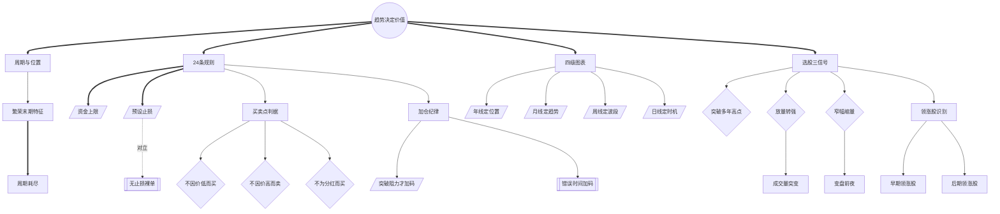

<!-- 内容属性：AI 辅助生成的知识蒸馏成果，非原书替代品。知识截止 2026-10。原书：《江恩选股方略》，威廉·D·江恩（William D. Gann） 著。 -->

# 《江恩选股方略》蒸馏稿 · D5 图谱 · M 档

**用图表、交易规则与选股方略回顾并预判股市** ｜ 威廉·D·江恩（William D. Gann） 著 · 何君 译 ｜ 华尔街经典译丛 05 · 地震出版社 ｜ 原书 137,057 字，共 9 章

## 〇、内容属性声明

- **AI 生成属性**：本稿由 AI 辅助生成，是对原书的深度知识蒸馏成果，不构成原书替代品。所有判断以原书为准。
- **知识截止**：2026-10。原书为《Wall Street Stock Selector》（1930 年），以 1900—1930 年美股为样本；此后信息披露、指数编制与交易机制已根本改变，方法框架可迁移，个股案例不可照搬。
- **版权提示**：本稿不含原书连续正文；引用单条不超过 100 字，全篇引用总量低于正文的 5%。原书著作权归作者与出版方所有。
- **引用规则**：所有命题均带章节锚点，可按章回查；蒸馏者归纳的推论均单独标注。

## 一、蒸馏契约卡

| 字段 | 取值 |
|---|---|
| 蒸馏形态 | D5 概念图谱（并行产出 D1 精华、D2 模型、D3 行动、附录及可视化图鉴） |
| 深度档位 | M 标准蒸馏 |
| 目标读者 | 选股研究者、趋势交易者、希望建立选股与加仓纪律的投资者 |
| 复用场景 | 选股筛选、买卖点确定、加仓节奏、顶部底部识别 |
| 原书可得性 | 全文可得：共 9 章，原书 137,057 字（中文字符计） |
| 蒸馏比（DR） | 蒸馏稿正文约 3.8 千字 ÷ 原书 137,057 ≈ 2.8%（稳居 M 档区间 1.5%~4%） |
| 图表处置 | 原书年线、月线、周线与摆动图已按图注定位导出 20 幅（保留原页码），附录建立专属索引 |
| 骨架类型 | 实践型（工具方法 · 选股与交易） |

## 二、正文主体

### 全书骨架

**骨架类型**：实践型（工具方法 · 选股与交易）

**判定依据**：全书九章构成「规则—教育—图表—选股—交易—龙头—未来」的递进：先以 24 条交易规则立规矩，再用华尔街的历史教训说明为何规则不可违，随后依次展开时间周期图表法、选股方法、投资者操作法、领涨股识别与未来判断。

- 趋势决定价值是统摄全部概念的根节点（第2章·24 条始终可靠的交易规则）
- 周期与位置判断市场整体所处阶段（第1章·股市新纪元与变化了的周期）
- 24 条规则派生资金上限、预设止损与买卖点判据（第2章）
- 四级图表派生年线定位置至日线定时机（第4章·不同时间周期的表与趋势变化）
- 选股三信号派生出领涨股识别（第5章、第7章）
- 加仓纪律与繁荣末期特征构成动作与风险层（第6章、第8章）

---

### 模块一：Mermaid 概念网络图

本图谱共 29 个概念节点，运用 3 种连线样式（实线依赖、粗实线主干、虚线对立或构成），零孤岛节点。

---

### 模块二：术语词典（严格 29 条双向对应）

本词典与图谱节点 ID 严格一一双向对应（节点数守恒律：图谱 29 节点 == 词典 29 条）。

| 编号 | 术语 | 类型 | 定义 | 首次出现 | 作者特有用法 | 节点 ID |
|---|---|---|---|---|---|---|
| T01 | 趋势决定价值 | 根概念 | 价格高低本身不构成买卖理由，趋势才是 | 第2章·24 条始终可靠的交易规则 | 把「便宜」与「值得买」彻底分开 | ROOT |
| T02 | 周期与位置 | 核心概念 | 以周期长度判断市场处于繁荣或衰退 | 第1章·股市新纪元与变化了的周期 | 否认新纪元叙事，坚持周期约束 | C01 |
| T03 | 24条规则 | 核心概念 | 覆盖资金、买卖点、加仓的完整约束集 | 第2章·24 条始终可靠的交易规则 | 每条都给出可执行阈值，不留裁量空间 | C02 |
| T04 | 资金上限 | 方法 | 单次投入不超过本金固定比例 | 第2章·24 条始终可靠的交易规则 | 以能承受几次连亏设计仓位 | C03 |
| T05 | 预设止损 | 方法 | 入场即挂、绝不撤销的止损单 | 第2章·24 条始终可靠的交易规则 | 把止损当作准入条件而非选项 | C04 |
| T06 | 买卖点判据 | 核心概念 | 由三条戒律与两类信号构成的买卖规则 | 第2章·24 条始终可靠的交易规则 | 用客观信号替代主观估值 | C05 |
| T07 | 不因价低而买 | 判据 | 低价必有低价的原因，不构成买入理由 | 第2章·24 条始终可靠的交易规则 | 直指抄底行为的认知误区 | C06 |
| T08 | 不因价高而卖 | 判据 | 高价可更高，须以趋势决定去留 | 第2章·24 条始终可靠的交易规则 | 反对「涨多了就该卖」的直觉 | C07 |
| T09 | 不为分红而买 | 判据 | 分红不改变趋势方向 | 第2章·24 条始终可靠的交易规则 | 把股息与资本利得分开评估 | C08 |
| T10 | 四级图表 | 核心概念 | 年、月、周、日各承担一类判断 | 第4章·不同时间周期的表与趋势变化 | 禁止越级推翻结论 | C09 |
| T11 | 年线定位置 | 方法 | 以年线判断历史新高区或底部区 | 第4章·不同时间周期的表与趋势变化 | 回答「这只股票在历史上的位置」 | C10 |
| T12 | 月线定趋势 | 方法 | 以月线确认主趋势方向 | 第4章·不同时间周期的表与趋势变化 | 主趋势反转的唯一依据 | C11 |
| T13 | 周线定波段 | 方法 | 以周线定位当前处于第几次回调 | 第4章·不同时间周期的表与趋势变化 | 波段节奏的度量尺 | C12 |
| T14 | 日线定时机 | 方法 | 仅在活跃行情中用于扣扳机 | 第4章·不同时间周期的表与趋势变化 | 信号有效期最短的一级 | C13 |
| T15 | 选股三信号 | 核心概念 | 突破、放量、窄幅缩量三类筛选信号 | 第5章·成功选择股票的方法 | 只买已被市场证明的强势 | C14 |
| T16 | 突破多年高点 | 判据 | 穿越多年前最高价进入筹码真空 | 第5章·成功选择股票的方法 | 突破后往往不回头 | C15 |
| T17 | 放量转强 | 判据 | 突然活跃并伴随巨大成交量 | 第5章·成功选择股票的方法 | 至少是临时性领涨股 | C16 |
| T18 | 窄幅缩量 | 判据 | 连续窄幅波动且成交量很小 | 第5章·成功选择股票的方法 | 方向未知但变盘在即 | C17 |
| T19 | 领涨股识别 | 核心概念 | 以启动时点与蓄势时长区分领涨股类型 | 第7章·如何挑选早期的领涨股 | 越早启动、蓄势越久，持续性越强 | C18 |
| T20 | 早期领涨股 | 派生概念 | 先于大盘止跌、窄幅蓄势、率先突破 | 第7章·如何挑选早期的领涨股 | 下一轮行情的主力 | C19 |
| T21 | 后期领涨股 | 派生概念 | 大盘中后段启动、涨幅快但无蓄势 | 第7章·如何挑选后期的领涨股 | 情绪扩散的产物，持续性差 | C20 |
| T22 | 加仓纪律 | 核心概念 | 只在突破阻力后加码且递减加量 | 第6章·投资者应该如何进行交易 | 让加仓成为浮盈再分配 | C21 |
| T23 | 突破阻力才加码 | 方法 | 加仓的前置条件是突破下一阻力位 | 第2章·24 条始终可靠的交易规则 | 绝不在回调中补仓 | C22 |
| T24 | 错误时间加码 | 反概念 | 在未突破或回调中追加头寸 | 第2章·24 条始终可靠的交易规则 | 被明确列为24条规则之一 | C23 |
| T25 | 无止损裸单 | 反概念 | 未挂止损即持有的头寸 | 第2章·24 条始终可靠的交易规则 | 视为违规单 | C24 |
| T26 | 繁荣末期特征 | 判据 | 量增价滞、领涨股滞涨、公众参与见顶 | 第8章·股市的未来表现 | 三特征同时出现即周期尾部 | C25 |
| T27 | 周期耗尽 | 判据 | 时间到而价格无法创新高 | 第1章·股市新纪元与变化了的周期 | 推动力枯竭的信号 | C26 |
| T28 | 成交量突变 | 判据 | 成交量相对常态突然放大数倍 | 第5章·成功选择股票的方法 | 最难伪装的主力痕迹 | C27 |
| T29 | 变盘前夜 | 判据 | 低波动与低成交量的持续聚集 | 第5章·成功选择股票的方法 | 波动率压缩后往往剧烈释放 | C28 |

---

### 模块三：概念关系矩阵

| 维度 | 源概念 | 目标概念 | 关系类型 | 语义阐释 |
|---|---|---|---|---|
| 逻辑支撑 | C02 24条规则 | C05 买卖点判据 | 结构包含 | 买卖点是规则集的核心子集。 |
| 对立冲突 | C05 预设止损 | C25 无止损裸单 | 对立关系 | 止损是入场前置条件。 |
| 对立冲突 | C21 加仓纪律 | C24 错误时间加码 | 对立关系 | 加仓需突破前提，补仓无前提。 |
| 正向增强 | C10 年线定位置 | C16 突破多年高点 | 同构增强 | 年线给出的历史高点正是突破判据的锚。 |
| 因果驱动 | C26 繁荣末期特征 | C27 周期耗尽 | 因果解释 | 三特征同时出现即周期耗尽的表征。 |
| 试金检验 | C17 放量转强 | C15 突破多年高点 | 交叉验证 | 放量可验证突破的真伪。 |

---

### 适用边界与失效条件

| 维度 | 具体表述 |
|---|---|
| 常态规律 | 突破多年高点**通常**在成熟大盘股上最有效。 |
| 环境要求 | **在**价格序列连续、无频繁拆股**条件下**历史极值才可比。 |
| 失效条件 | 当公司发生重大重组或退市风险时，历史极值**失效**。 |
| 不适用场景 | 上市不足三年、无历史极值的新股**不适用**该判据。 |
| 适用范围 | 24 条规则**仅适用**于完整执行（含止损与减量）的交易者。 |

### 跨场景应用示例

- **量化选股**：把「突破多年前高点 + 放量 + 窄幅缩量」编译为三因子筛选器。
- **股权投资**：用「不因价低而买」审视估值陷阱，用「突破历史高点」识别真正的成长股。
- **职业选择**：用领涨股时点模型判断加入某行业的时点，避免在情绪顶点入场。

---

### 最小行动卡

| 字段 | 内容 |
|---|---|
| **触发** | 个股穿越多年前最高价，或突然放量转强成为领涨股 |
| **动作** | 突破确认后买入，同步在突破位下方 3 点挂止损；活跃度维持且突破下一阻力时递减加仓 |
| **时长** | 盘后选股与图表复核 30 分钟；周线复核每周一次；持仓每月全面审计 |
| **验收** | 记录须写明突破的历史高点年份、放量倍数、止损价与加仓阶梯；无止损视为违规 |
| **复现** | 换第二名研究者依同一规则筛选，选出的标的集合重合度应≥80% |

## 三、命题表

四层权重：L1 骨架 1.0 / L2 论证链 0.7 / L3 支撑论据 0.3 / L4 修辞 0.1。

| 编号 | 命题内容 | 层级 | 权重 | 锚点 | 来源 |
|---|---|---|---|---|---|
| P001 | 周期不会因「新纪元」叙事消失，繁荣终将接受周期检验。 | L1 | 1.0 | 第1章·股市新纪元与变化了的周期 | 原书 |
| P002 | 单笔投入不超本金固定比例，连亏后减量而非加倍。 | L1 | 1.0 | 第2章·24 条始终可靠的交易规则 | 原书 |
| P003 | 任何交易都须预设止损，入场即挂、绝不撤销。 | L1 | 1.0 | 第2章·24 条始终可靠的交易规则 | 原书 |
| P004 | 不要仅因价格低而买进，也不要仅因价格高而卖空。 | L1 | 1.0 | 第2章·24 条始终可靠的交易规则 | 原书 |
| P005 | 不要仅为获得分红而买进。 | L1 | 1.0 | 第2章·24 条始终可靠的交易规则 | 原书 |
| P006 | 不要在错误的时间加码，须等活跃并穿越阻力。 | L1 | 1.0 | 第2章·24 条始终可靠的交易规则 | 原书 |
| P007 | 股票首次进入新价位即卖出是错误的。 | L2 | 0.7 | 第2章·24 条始终可靠的交易规则 | 原书 |
| P008 | 应远离自动报价机，在收市后分析股市。 | L2 | 0.7 | 第2章·24 条始终可靠的交易规则 | 原书 |
| P009 | 连续几天窄幅波动且成交量很小，是顶部或底部即将出现的信号。 | L1 | 1.0 | 第5章·成功选择股票的方法 | 原书 |
| P010 | 穿越多年前形成的最高价即为非常强势的形态。 | L1 | 1.0 | 第5章·成功选择股票的方法 | 原书 |
| P011 | 突然活跃并伴随巨大成交量者，至少是临时性领涨股。 | L1 | 1.0 | 第5章·成功选择股票的方法 | 原书 |
| P012 | 快速上涨六七周，往往标志向上摆动到达顶峰。 | L1 | 1.0 | 第7章·如何挑选早期的领涨股 | 原书 |
| P013 | 年线定历史位置，月线定主趋势，周线定波段，日线定时机。 | L1 | 1.0 | 第4章·不同时间周期的表与趋势变化 | 原书 |
| P014 | 市场从不击垮交易者，击垮交易者的是不肯认错的习惯。 | L2 | 0.7 | 第3章·华尔街的教育 | 原书 |
| P015 | 加仓须等突破阻力，且加仓量应递减。 | L1 | 1.0 | 第6章·投资者应该如何进行交易 | 原书 |
| P016 | 持仓须定期复核趋势与关键支撑，不可放任。 | L2 | 0.7 | 第6章·投资者应该如何进行交易 | 原书 |
| P017 | 早期领涨股先于大盘止跌、窄幅蓄势、率先突破。 | L1 | 1.0 | 第7章·如何挑选早期的领涨股 | 原书 |
| P018 | 后期领涨股在大盘中后段启动，涨幅快但持续性差。 | L2 | 0.7 | 第7章·如何挑选后期的领涨股 | 原书 |
| P019 | 繁荣末期常同时出现量增价滞、领涨股滞涨、公众参与见顶。 | L1 | 1.0 | 第8章·股市的未来表现 | 原书 |
| P020 | 板块龙头会轮换，昨日龙头可能是明日落后者。 | L2 | 0.7 | 第9章·未来状况与发展 | 原书 |

## 四、还原索引

| 命题编号 | 蒸馏稿落点 | 原书锚点 |
|---|---|---|
| P001 | 正文骨架 / 摘要第1段 | 第1章·股市新纪元与变化了的周期 |
| P002 | 正文骨架 / 摘要第2段 | 第2章·24 条始终可靠的交易规则 |
| P003 | 正文骨架 / 摘要第3段 | 第2章·24 条始终可靠的交易规则 |
| P004 | 正文骨架 / 摘要第4段 | 第2章·24 条始终可靠的交易规则 |
| P005 | 正文骨架 / 摘要第5段 | 第2章·24 条始终可靠的交易规则 |
| P006 | 正文骨架 / 摘要第6段 | 第2章·24 条始终可靠的交易规则 |
| P007 | 模型机制 / SOP 步骤 | 第2章·24 条始终可靠的交易规则 |
| P008 | 模型机制 / SOP 步骤 | 第2章·24 条始终可靠的交易规则 |
| P009 | 正文骨架 / 摘要第1段 | 第5章·成功选择股票的方法 |
| P010 | 正文骨架 / 摘要第2段 | 第5章·成功选择股票的方法 |
| P011 | 正文骨架 / 摘要第3段 | 第5章·成功选择股票的方法 |
| P012 | 正文骨架 / 摘要第4段 | 第7章·如何挑选早期的领涨股 |
| P013 | 正文骨架 / 摘要第5段 | 第4章·不同时间周期的表与趋势变化 |
| P014 | 模型机制 / SOP 步骤 | 第3章·华尔街的教育 |
| P015 | 正文骨架 / 摘要第7段 | 第6章·投资者应该如何进行交易 |
| P016 | 模型机制 / SOP 步骤 | 第6章·投资者应该如何进行交易 |
| P017 | 正文骨架 / 摘要第1段 | 第7章·如何挑选早期的领涨股 |
| P018 | 模型机制 / SOP 步骤 | 第7章·如何挑选后期的领涨股 |
| P019 | 正文骨架 / 摘要第3段 | 第8章·股市的未来表现 |
| P020 | 模型机制 / SOP 步骤 | 第9章·未来状况与发展 |

## 五、剔除台账

| 编号 | 被删内容摘要 | 冗余类型 | 删除理由 | 原书锚点 | 可挽回性 |
|---|---|---|---|---|---|
| X-001 | 「不因价低价高而买卖、不为分红而买」在全书重复 5 次 | R1 | 与 P005 同构，保留第二章最完整表述 | 第2章·24 条始终可靠的交易规则 | 可读回原文 |
| X-002 | 30 余幅个股年线、月线图的逐图讲解（约 60 页） | R2 | 同构例证，保留西屋电气、美国钢铁两个代表案例，其余登记索引 | 第5章·成功选择股票的方法 | 已登记论据索引 |
| X-003 | 《圣经》箴言与所罗门王引言等修辞约 18 处 | R3 | 文化衬托，不含操作判据 | 第3章·华尔街的教育 | 可读回原文 |
| X-004 | 1927—1929 年新纪元叙事与胡佛政府政策的长篇评论 | R4 | 特定时代背景，压缩为「周期被乐观遮蔽」一句 | 第1章·股市新纪元与变化了的周期 | 要点已保留 |
| X-005 | 各年度纽约证券交易所成交量与总市值数据表（约 10 页） | R2 | 提炼繁荣末期特征，原始数据登记索引 | 第8章·股市的未来表现 | 已登记论据索引 |
| X-006 | 铁路股、糖业股、航空股的历史行情逐段叙述 | R2 | 板块标的已失效，提炼板块轮动与龙头更替原则 | 第9章·未来状况与发展 | 要点已保留 |
| X-007 | 作者自述研究经历与推介其他著作 | R5 | 个人宣传，无通用信息增量 | 第3章·华尔街的教育 | 可读回原文 |
| X-008 | 对当时政客与媒体误导公众的长篇批评 | R3 | 情绪化评论，压缩为结论 | 第3章·华尔街的教育 | 可读回原文 |

## 六、复核清单

1. 能否说出「不因价低而买、不因价高而卖、不为分红而买」各自针对的认知误区？
2. 为什么突破多年前最高价之后往往不会回调？
3. 四级图表分别回答什么问题？为什么不能越级？
4. 早期领涨股与后期领涨股的核心区别是什么？
5. 繁荣末期通常同时出现哪三个特征？

---

本蒸馏稿可一键导出为 PDF / Word / HTML 等主流格式。
