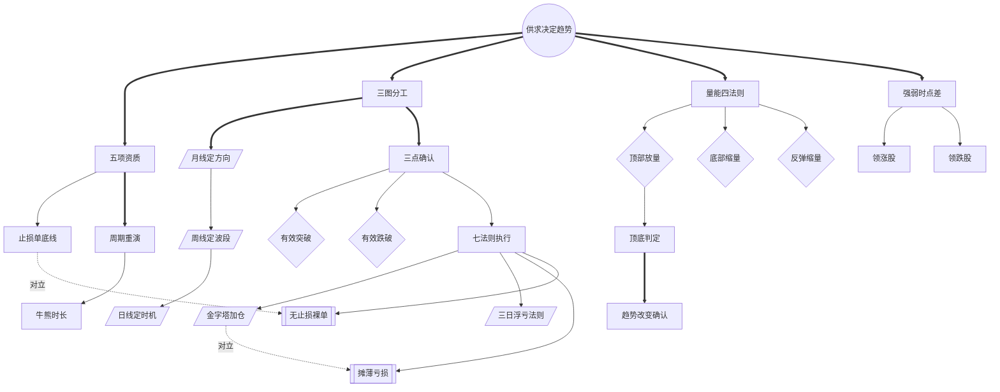

<!-- 内容属性：AI 辅助生成的知识蒸馏成果，非原书替代品。知识截止 2026-10。原书：《江恩股票走势探测》，威廉·D·江恩（William D. Gann） 著。 -->

# 《江恩股票走势探测》蒸馏稿 · D5 图谱 · M 档

**用三图判势、三点确认与量能验证捕捉个股趋势** ｜ 威廉·D·江恩（William D. Gann） 著 ｜ 江恩股票经典系列 ｜ 原书 71,729 字，共 8 章

## 〇、内容属性声明

- **AI 生成属性**：本稿由 AI 辅助生成，是对原书的深度知识蒸馏成果，不构成原书替代品。所有判断以原书为准。
- **知识截止**：2026-10。原书成稿于 1936 年，以 1929—1935 年美股为样本；此后卖空规则、保证金制度与程序化交易已根本改变，方法框架可迁移，具体点位不可照搬。
- **版权提示**：本稿不含原书连续正文；引用单条不超过 100 字，全篇引用总量低于正文的 5%。原书著作权归作者与出版方所有。
- **引用规则**：所有命题均带章节锚点，可按章回查；蒸馏者归纳的推论均单独标注。

## 一、蒸馏契约卡

| 字段 | 取值 |
|---|---|
| 蒸馏形态 | D5 概念图谱（并行产出 D1 精华、D2 模型、D3 行动、附录及可视化图鉴） |
| 深度档位 | M 标准蒸馏 |
| 目标读者 | 个股交易者、趋势跟踪策略研究员、需要建立选股与止损纪律的投资者 |
| 复用场景 | 个股筛选、买卖点判定、止损设置、持仓跟踪 |
| 原书可得性 | 全文可得：共 8 章，原书 71,729 字（中文字符计） |
| 蒸馏比（DR） | 蒸馏稿正文约 2.6 千字 ÷ 原书 71,729 ≈ 3.6%（稳居 M 档区间 1.5%~4%） |
| 图表处置 | 原书 88 幅月线、周线、日线示意图已完整提取留存于 figures/ 目录，附录建立专属索引 |
| 骨架类型 | 实践型（工具方法 · 个股交易） |

## 二、正文主体

### 全书骨架

**骨架类型**：实践型（工具方法 · 个股交易）

**判定依据**：全书先立五项资质与止损底线，再以八十年牛熊复盘建立周期感，随后给出「三图分工 + 三点确认」的七条实用法则，最后用量能与克莱斯勒十年实盘完成验证闭环。

- 供求决定趋势是统摄全部概念的根节点（第1章·供求规律）
- 五项资质派生止损单底线与资金纪律（第2章·成功交易的基础）
- 三图分工向下派生三点确认与买卖点判据（第5章·研判趋势的最佳工具）
- 量能四法则为价格结论提供独立旁证（第6章·成交量）
- 强弱时点差输出领涨股与领跌股（第5章·如何找到强势股）
- 七法则执行把上述判据编译为可复现动作（第7章·实用交易方法）

---

### 模块一：Mermaid 概念网络图

本图谱共 26 个概念节点，运用 3 种连线样式（实线依赖、粗实线主干、虚线对立或构成），零孤岛节点。

---

### 模块二：术语词典（严格 26 条双向对应）

本词典与图谱节点 ID 严格一一双向对应（节点数守恒律：图谱 26 节点 == 词典 26 条）。

| 编号 | 术语 | 类型 | 定义 | 首次出现 | 作者特有用法 | 节点 ID |
|---|---|---|---|---|---|---|
| T01 | 供求决定趋势 | 根概念 | 买盘大于卖盘则涨，反之则跌 | 第1章·供求规律 | 把消息、操纵、政策都还原为供求对比 | ROOT |
| T02 | 五项资质 | 核心概念 | 知识、耐心、胆量、健康、资金 | 第2章·成功股民的必备资质 | 把健康列为硬条件 | C01 |
| T03 | 三图分工 | 核心概念 | 月线定方向、周线定波段、日线定时机 | 第5章·研判趋势的最佳工具 | 禁止用日线推翻月线结论 | C02 |
| T04 | 止损单底线 | 方法 | 入场即挂、不撤销的 1~3 点止损 | 第2章·成功交易的基础 | 把止损视为不需判断的自动动作 | C03 |
| T05 | 月线定方向 | 方法 | 以月高低点序列判断大方向 | 第5章·研判趋势的最佳工具 | 识别吸货与派发的最佳分辨率 | C04 |
| T06 | 周线定波段 | 方法 | 以周高低点判定波段与止损位 | 第5章·研判趋势的最佳工具 | 设置止损的基准图 | C05 |
| T07 | 日线定时机 | 方法 | 仅在活跃行情中判定短期转折 | 第5章·研判趋势的最佳工具 | 日线信号有效期仅 3~7 天 | C06 |
| T08 | 三点确认 | 核心概念 | 突破或跌破前高前低超三点才算有效 | 第5章·在什么位置买卖股票 | 同时过滤假突破并给出挂单位置 | C07 |
| T09 | 有效突破 | 判据 | 站上前高三点且回抽不破前高下三点 | 第5章·在什么位置买卖股票 | 被突破顶部越久远意义越重大 | C08 |
| T10 | 有效跌破 | 判据 | 跌破前低三点且反弹不过前低上三点 | 第5章·在什么位置买卖股票 | 破位后反抽不过前低即确认向下 | C09 |
| T11 | 量能四法则 | 核心概念 | 以顶部放量、底部缩量、反弹缩量验证价格 | 第6章·成交量 | 量能是难以长期造假的独立旁证 | C10 |
| T12 | 顶部放量 | 判据 | 牛市末尾放量，标志行情至少暂时终结 | 第6章·成交量 | 放量须结合位置判断 | C11 |
| T13 | 底部缩量 | 判据 | 长跌后缩量且波幅收窄，抛盘衰竭 | 第6章·成交量 | 地量见底的实证 | C12 |
| T14 | 反弹缩量 | 判据 | 反弹量能小于顶部量能，趋势仍向下 | 第6章·成交量 | 缩量反弹是空头回补 | C13 |
| T15 | 强弱时点差 | 核心概念 | 以相对大盘见顶见底的时点差判强弱 | 第5章·如何找到强势股 | 强弱由时点而非涨幅决定 | C14 |
| T16 | 领涨股 | 派生概念 | 提前见底、率先突破前年高点者 | 第5章·如何在牛市中找出早期领涨股 | 下一轮行情涨幅居前 | C15 |
| T17 | 领跌股 | 派生概念 | 提前见顶、反弹无力者 | 第5章·如何在熊市中找出早期的领跌股 | 提前下跌是提前派发 | C16 |
| T18 | 周期重演 | 核心概念 | 牛熊长度与时点按历史统计周期重现 | 第3章·历史在重演 | 以八十年数据建立时长直觉 | C17 |
| T19 | 牛熊时长 | 判据 | 牛市约 22~50 个月，熊市约 11~52 个月 | 第3章·历史在重演 | 判断行情是否已走得够久 | C18 |
| T20 | 七法则执行 | 核心概念 | 资金、止损、买卖点、加仓、转换、量能的闭环 | 第7章·实用交易方法 | 七条咬合，缺一失效 | C19 |
| T21 | 金字塔加仓 | 方法 | 按价格区间固定间隔加仓、累计后递减 | 第7章·第五条法则 | 20~50 美元每 5 点、80~200 每 10 点 | C20 |
| T22 | 三日浮亏法则 | 判据 | 连续三日收盘浮亏即判错误，立即平仓 | 第5章·买卖股票后的持股时间 | 把判断正确与否转为可观测事实 | C21 |
| T23 | 摊薄亏损 | 反概念 | 在亏损头寸加仓以拉低均价 | 第7章·第五条法则 | 被点名为最常犯的致命错误 | C22 |
| T24 | 无止损裸单 | 反概念 | 未挂保护性止损即持有的头寸 | 第2章·成功交易的基础 | 视为违规单 | C23 |
| T25 | 顶底判定 | 判据 | 以形态、三点突破与量能三方交叉确认 | 第6章·成交量 | 单一判据不构成结论 | C24 |
| T26 | 趋势改变确认 | 判据 | 跌破前低三点且反弹不过、量能配合 | 第5章·在什么位置买卖股票 | 确认前只调整仓位不改方向 | C25 |

---

### 模块三：概念关系矩阵

| 维度 | 源概念 | 目标概念 | 关系类型 | 语义阐释 |
|---|---|---|---|---|
| 逻辑支撑 | C02 三图分工 | C08 三点确认 | 支撑关系 | 方向确定后才需设有效性阈值。 |
| 对立冲突 | C03 止损单底线 | C24 无止损裸单 | 对立关系 | 止损是入场前置条件。 |
| 对立冲突 | C20 金字塔加仓 | C22 摊薄亏损 | 对立关系 | 加仓用浮盈，摊平用本金。 |
| 正向增强 | C10 量能四法则 | C25 顶底判定 | 交叉验证 | 价格给形状，量能给兵力。 |
| 因果驱动 | C15 强弱时点差 | C16 领涨股 | 筛选输出 | 时点差是机制，领涨股是结果。 |

---

### 适用边界与失效条件

| 维度 | 具体表述 |
|---|---|
| 常态规律 | 三点确认**通常**在活跃中大盘股上最有效。 |
| 环境要求 | **在**可挂止损单、无涨跌停限制**条件下**阈值可直接套用。 |
| 失效条件 | 遇并购、拆股或指数调整导致跳空时，三点阈值**失效**。 |
| 不适用场景 | 买卖价差已超过三个点的冷门股**不适用**。 |
| 适用范围 | 金字塔加仓**仅适用**于首笔已浮盈的头寸。 |

### 跨场景应用示例

- **量化选股**：把三图方向、三点突破、量能三条件编译为多因子过滤器。
- **私募风控**：把三日浮亏法则迁移为「新策略三个月未达基准即下线」。
- **个人投资**：月线定投方向、周线定加仓节奏、三点阈值控制买入成本。

---

### 最小行动卡

| 字段 | 内容 |
|---|---|
| **触发** | 月线向上、周线回调至前高或双底、日线企稳 |
| **动作** | 双底或突破前高三点回调处买入，同步挂底部下方三点止损 |
| **时长** | 盘后三图核对 15 分钟；盘中下单 2 分钟；每三日复核浮盈 |
| **验收** | 记录三图方向、买入依据、止损价；三日浮亏未平仓视为违规 |
| **复现** | 换第二名交易员复核，止损位与买入位误差不超过一个点 |

## 三、命题表

四层权重：L1 骨架 1.0 / L2 论证链 0.7 / L3 支撑论据 0.3 / L4 修辞 0.1。

| 编号 | 命题内容 | 层级 | 权重 | 锚点 | 来源 |
|---|---|---|---|---|---|
| P003 | 历史按周期重演：战起恐慌、战后繁荣、战终暴跌 | L1 | 1.0 | 第3章·历史在重演 | 原书 |
| P004 | 牛市约 22~50 个月，熊市约 11~52 个月。 | L1 | 1.0 | 第3章·历史在重演 | 原书 |
| P007 | 月线定方向、周线定波段、日线定时机。 | L1 | 1.0 | 第5章·研判趋势的最佳工具 | 原书 |
| P008 | 突破前高须站上三点且回抽不破前高下方三点。 | L1 | 1.0 | 第5章·在什么位置买卖股票 | 原书 |
| P009 | 跌破前低三点且反弹不过前低上方三点，方确认破位。 | L1 | 1.0 | 第5章·在什么位置买卖股票 | 原书 |
| P010 | 双底三底买入、双顶三顶卖出，止损一至三点。 | L1 | 1.0 | 第5章·在什么位置买卖股票 | 原书 |
| P011 | 连续三日收盘浮亏即判错误，立即平仓。 | L1 | 1.0 | 第5章·买卖股票后的持股时间 | 原书 |
| P012 | 提前见顶者领跌，提前见底者领涨。 | L1 | 1.0 | 第5章·如何在牛市中找出早期领涨股 | 原书 |
| P015 | 单次投入不超本金十分之一，止损一至三点、风险不超五点。 | L1 | 1.0 | 第7章·第一条法则 | 原书 |
| P016 | 突破前高三点后回抽不破即买，跌破前低三点后反弹即卖。 | L1 | 1.0 | 第7章·第三条法则 | 原书 |
| P017 | 金字塔加仓：20~50 美元每五点、80~200 美元每十点。 | L1 | 1.0 | 第7章·第五条法则 | 原书 |
| P018 | 严禁摊薄亏损，此为交易者最常犯的致命错误。 | L1 | 1.0 | 第7章·第五条法则 | 原书 |
| P020 | 下一轮熊市的导火索是上一轮繁荣中被视为理所当然之物。 | L2 | 0.7 | 第8章·现在已经发生的事情将是下次熊市的导火索 | 原书 |

## 四、还原索引

| 命题编号 | 蒸馏稿落点 | 原书锚点 |
|---|---|---|
| P003 | 正文骨架 / 摘要第1段 | 第3章·历史在重演 |
| P004 | 正文骨架 / 摘要第2段 | 第3章·历史在重演 |
| P007 | 正文骨架 / 摘要第3段 | 第5章·研判趋势的最佳工具 |
| P008 | 正文骨架 / 摘要第4段 | 第5章·在什么位置买卖股票 |
| P009 | 正文骨架 / 摘要第5段 | 第5章·在什么位置买卖股票 |
| P010 | 正文骨架 / 摘要第6段 | 第5章·在什么位置买卖股票 |
| P011 | 正文骨架 / 摘要第7段 | 第5章·买卖股票后的持股时间 |
| P012 | 正文骨架 / 摘要第8段 | 第5章·如何在牛市中找出早期领涨股 |
| P015 | 正文骨架 / 摘要第1段 | 第7章·第一条法则 |
| P016 | 正文骨架 / 摘要第2段 | 第7章·第三条法则 |
| P017 | 正文骨架 / 摘要第3段 | 第7章·第五条法则 |
| P018 | 正文骨架 / 摘要第4段 | 第7章·第五条法则 |
| P020 | 模型机制 / SOP 步骤 | 第8章·现在已经发生的事情将是下次熊市的导火索 |

## 五、剔除台账

| 编号 | 被删内容摘要 | 冗余类型 | 删除理由 | 原书锚点 | 可挽回性 |
|---|---|---|---|---|---|
| X-001 | 「人性弱点致亏损、须设止损」在第1、2、5、7章重复 5 次 | R1 | 与 P001、P015 同构，保留第二章最完整论述 | 第1章·为什么要指责华尔街、第2章·成功交易的基础 | 可读回原文 |
| X-002 | 1856—1935 年逐年牛熊点位与月份的完整罗列（约 40 页） | R2 | 提炼牛熊时长区间，逐年数据保留在 figures/ | 第3章·历史在重演 | 已登记论据索引 |
| X-003 | 《圣经》箴言与爱默生引言等修辞段落约 12 处 | R3 | 文化衬托，不含操作判据 | 第2章·成功交易的基础 | 可读回原文 |
| X-004 | 罗斯福新政与证券交易法立法过程的长篇评论 | R4 | 特定制度背景，压缩为一句注记 | 第1章·华尔街上的新政 | 要点已保留 |
| X-005 | 1929—1935 年纽交所逐月成交量完整表格（约 8 页） | R2 | 提炼顶底量能特征，逐月数据登记索引 | 第6章·成交量 | 已登记论据索引 |
| X-006 | 克莱斯勒 1925—1935 年逐周交易记录与每笔盈亏 | R2 | 验证性案例，提炼关键买卖点，明细留存 figures/ | 第7章·克莱斯勒汽车 | 已登记论据索引 |
| X-007 | 作者自述 35 年研究经历与推介其他著作 | R5 | 个人宣传，无通用信息增量 | 第2章·成功交易的基础 | 可读回原文 |
| X-008 | 航空类股、铜类股的个股名单式罗列 | R2 | 标的已失效，提炼板块轮动原则 | 第8章·未来的股市 | 要点已保留 |

## 六、复核清单

1. 能否说出月线、周线、日线各自负责回答什么问题？
2. 能否复述三点确认的完整判据（突破阈值、回抽条件、止损位置）？
3. 买入后连续三日收盘浮亏意味着什么？应当采取什么动作？
4. 成交量四条法则分别对应顶部、破位、底部、反弹的哪种形态？
5. 强弱时点差如何计算？提前见顶与提前见底分别预示什么？

---

本蒸馏稿可一键导出为 PDF / Word / HTML 等主流格式。
