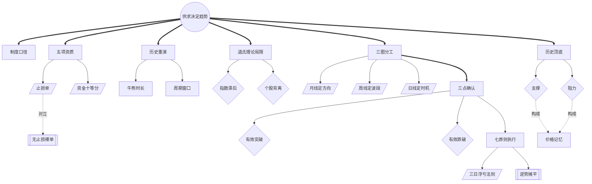

<!-- 内容属性：AI 辅助生成的知识蒸馏成果，非原书替代品。知识截止 2026-10。原书：《江恩股市趋势理论》，威廉·D·江恩（William D. Gann） 著。 -->

# 《江恩股市趋势理论》蒸馏稿 · D5 图谱 · M 档

**专业解读版：趋势探测器的七章结构与解读增补** ｜ 威廉·D·江恩（William D. Gann） 著 · 张艺博 译解 ｜ 专业解读版 ｜ 原书 111,373 字，共 7 章

## 〇、内容属性声明

- **AI 生成属性**：本稿由 AI 辅助生成，是对原书的深度知识蒸馏成果，不构成原书替代品。所有判断以原书为准。
- **知识截止**：2026-10。原书为 New Stock Trend Detector（1936），与《江恩股票走势探测》同源异译；本版增补译者逐章解读。原书样本止于 1935 年，方法框架可迁移，点位不可照搬。
- **版权提示**：本稿不含原书连续正文；引用单条不超过 100 字，全篇引用总量低于正文的 5%。原书著作权归作者与出版方所有。
- **引用规则**：所有命题均带章节锚点，可按章回查；蒸馏者归纳的推论均单独标注。

## 一、蒸馏契约卡

| 字段 | 取值 |
|---|---|
| 蒸馏形态 | D5 概念图谱（并行产出 D1 精华、D2 模型、D3 行动、附录及可视化图鉴） |
| 深度档位 | M 标准蒸馏 |
| 目标读者 | 希望对照两个中译本的进阶读者、趋势交易者、技术分析教学者 |
| 复用场景 | 版本对照研读、趋势探测实操、教学备课 |
| 原书可得性 | 全文可得：共 7 章，原书 111,373 字（中文字符计） |
| 蒸馏比（DR） | 蒸馏稿正文约 3.1 千字 ÷ 原书 111,373 ≈ 2.8%（稳居 M 档区间 1.5%~4%） |
| 图表处置 | 原书为扫描版 PDF，已按图注定位导出 13 幅重要图表并保留原页码；可与《江恩股票走势探测》figures/ 交叉参照 |
| 骨架类型 | 实践型（工具方法 · 趋势探测） |

## 二、正文主体

### 全书骨架

**骨架类型**：实践型（工具方法 · 趋势探测）

**判定依据**：七章构成「规则—基础—历史—批判—方法—顶底—原则」的递进：先立新交易规则，再谈成功基础，用历史证明重演，批判道氏理论的局限，给出趋势探测方法，聚焦顶底识别，最后以实用原则收束。

- 供求决定趋势是统摄全部概念的根节点（第一章·全新的华尔街交易规则）
- 制度口径约束全部历史阈值的可比性（第一章·全新的华尔街交易规则）
- 五项资质派生止损单与资金十等分（第二章·成功交易的基础）
- 三图分工派生三点确认与买卖点（第五章·最好的趋势探测方法）
- 历史顶底通过价格记忆构成支撑阻力（第六章）
- 七原则执行把判据编译为可复现动作（第七章·实用交易原则）

---

### 模块一：Mermaid 概念网络图

本图谱共 26 个概念节点，运用 3 种连线样式（实线依赖、粗实线主干、虚线对立或构成），零孤岛节点。

---

### 模块二：术语词典（严格 26 条双向对应）

本词典与图谱节点 ID 严格一一双向对应（节点数守恒律：图谱 26 节点 == 词典 26 条）。

| 编号 | 术语 | 类型 | 定义 | 首次出现 | 作者特有用法 | 节点 ID |
|---|---|---|---|---|---|---|
| T01 | 供求决定趋势 | 根概念 | 买盘大于卖盘则涨，反之则跌 | 第一章·全新的华尔街交易规则 | 制度变化不改变这一底层法则 | ROOT |
| T02 | 制度口径 | 核心概念 | 交易规则、保证金与统计口径的可比性 | 第一章·全新的华尔街交易规则 | 形可迁移，数须重标 | C01 |
| T03 | 五项资质 | 核心概念 | 知识、耐心、胆量、健康、资金 | 第二章·成功交易的基础 | 把健康列为硬条件 | C02 |
| T04 | 止损单 | 方法 | 入场即挂的 1~3 点保护性止损 | 第二章·成功交易的基础 | 把止损视为准入条件 | C03 |
| T05 | 资金十等分 | 方法 | 单次投入不超本金十分之一 | 第七章·实用交易原则 | 以能承受几次连亏设计仓位 | C04 |
| T06 | 历史重演 | 核心概念 | 牛熊长度与时点按周期重现 | 第三章·历史重演 | 以八十年数据建立时长直觉 | C05 |
| T07 | 牛熊时长 | 判据 | 牛市约 22~50 个月，熊市约 11~52 个月 | 第三章·历史重演 | 判断行情是否已走得够久 | C06 |
| T08 | 周期窗口 | 判据 | 顶底后一至三年的关键节点 | 第三章·历史重演 | 只提示窗口，不预测日期 | C07 |
| T09 | 道氏理论局限 | 核心概念 | 指数互相确认滞后且抹平个股差异 | 第四章·不合时宜的道氏理论 | 以个股判读替代指数确认 | C08 |
| T10 | 指数滞后 | 判据 | 确认完成时趋势往往已走大半 | 第四章·不合时宜的道氏理论 | 滞后型指标的固有缺陷 | C09 |
| T11 | 个股背离 | 判据 | 指数向上时仍有大量个股下跌 | 第四章·不合时宜的道氏理论 | 指数不能替代个股判断 | C10 |
| T12 | 三图分工 | 核心概念 | 月线定方向、周线定波段、日线定时机 | 第五章·最好的趋势探测方法 | 禁止越级推翻结论 | C11 |
| T13 | 月线定方向 | 方法 | 以月高低点序列判断大方向 | 第五章·最好的趋势探测方法 | 识别吸货与派发的分辨率 | C12 |
| T14 | 周线定波段 | 方法 | 以周高低点判定波段与止损位 | 第五章·最好的趋势探测方法 | 设置止损的基准图 | C13 |
| T15 | 日线定时机 | 方法 | 仅在活跃行情中判定短期转折 | 第五章·最好的趋势探测方法 | 信号有效期最短 | C14 |
| T16 | 三点确认 | 核心概念 | 突破或跌破超三点才算有效 | 第五章·最好的趋势探测方法 | 缓冲带兼过滤与挂单两用 | C15 |
| T17 | 有效突破 | 判据 | 站上前高三点且回抽不破 | 第五章·最好的趋势探测方法 | 须按股价百分比调整 | C16 |
| T18 | 有效跌破 | 判据 | 跌破前低三点且反弹不过 | 第五章·最好的趋势探测方法 | 破位后反抽不过即确认 | C17 |
| T19 | 历史顶底 | 核心概念 | 上一次行情的顶部与底部 | 第六章·关注上一次行情的顶部和底部 | 同时聚集解套盘与抄底盘 | C18 |
| T20 | 历史支撑 | 判据 | 历史底部构成支撑 | 第六章·关注上一次行情的顶部和底部 | 越久远的底支撑越强 | C19 |
| T21 | 历史阻力 | 判据 | 历史顶部构成阻力 | 第六章·关注上一次行情的顶部和底部 | 越久远的顶阻力越强 | C20 |
| T22 | 价格记忆 | 派生概念 | 历史成交价形成的心理锚点 | 第六章·关注上一次行情的顶部和底部 | 解释顶底为何反复有效 | C21 |
| T23 | 无止损裸单 | 反概念 | 未挂止损即持有的头寸 | 第二章·成功交易的基础 | 视为违规单 | C22 |
| T24 | 七原则执行 | 核心概念 | 资金、止损、买卖点、加仓、反手、量能闭环 | 第七章·实用交易原则 | 缺一即被情绪击穿 | C23 |
| T25 | 三日浮亏法则 | 判据 | 连续三日收盘浮亏即平仓 | 第七章·实用交易原则 | 把判断对错转为可观测事实 | C24 |
| T26 | 逆势摊平 | 反概念 | 亏损头寸加仓以拉低均价 | 第七章·实用交易原则 | 被明确禁止 | C25 |

---

### 模块三：概念关系矩阵

| 维度 | 源概念 | 目标概念 | 关系类型 | 语义阐释 |
|---|---|---|---|---|
| 逻辑支撑 | C02 制度口径 | C16 三点确认 | 前提约束 | 阈值须先按制度与价格量级重标。 |
| 对立冲突 | C03 止损单 | C22 无止损裸单 | 对立关系 | 止损是入场前置条件。 |
| 对立冲突 | C11 三图分工 | C09 指数滞后 | 替代关系 | 个股三图判读替代滞后的指数确认。 |
| 正向增强 | C18 历史顶底 | C16 三点确认 | 同构增强 | 历史位为三点缓冲带提供落点。 |
| 因果驱动 | C21 价格记忆 | C19 历史支撑 | 因果解释 | 成本记忆使历史底部成为支撑。 |
| 试金检验 | C24 七原则执行 | C25 三日浮亏法则 | 规则内嵌 | 浮亏法则为执行提供证伪期限。 |

---

### 适用边界与失效条件

| 维度 | 具体表述 |
|---|---|
| 常态规律 | 三点确认**通常**在活跃中大盘股上最有效。 |
| 环境要求 | **在**制度口径一致、价格连续**条件下**历史顶底才可比。 |
| 失效条件 | 拆股、并购或指数调整导致价格断层时，历史位**失效**。 |
| 不适用场景 | 买卖价差已超过三个点的冷门股**不适用**。 |
| 适用范围 | 三日浮亏法则**仅适用**于按规则入场并已挂止损的头寸。 |

### 跨场景应用示例

- **版本研究**：以本书与另一译本对照，建立「同源异译」的术语对照表。
- **教学备课**：用七章结构做课程骨架，用另一译本的案例做补充材料。
- **实盘应用**：以历史顶底与三点缓冲带构建挂单网格。

---

### 最小行动卡

| 字段 | 内容 |
|---|---|
| **触发** | 月线向上、周线回调至历史顶底附近、日线企稳 |
| **动作** | 在双底或突破前高三点后的回抽处买入，同步挂底部下方三点止损 |
| **时长** | 盘后三图核对 15 分钟；历史顶底标定每月一次 |
| **验收** | 记录须写明三图方向、所依据的历史顶底年份、止损价；三日浮亏未平仓视为违规 |
| **复现** | 换第二名交易员复核，止损位与买入位误差不超过一个点 |

## 三、命题表

四层权重：L1 骨架 1.0 / L2 论证链 0.7 / L3 支撑论据 0.3 / L4 修辞 0.1。

| 编号 | 命题内容 | 层级 | 权重 | 锚点 | 来源 |
|---|---|---|---|---|---|
| P001 | 制度变化改变走势节奏，但不改变供求决定价格的法则。 | L1 | 1.0 | 第一章·全新的华尔街交易规则 | 原书 |
| P002 | 成功需五项资质：知识、耐心、胆量、健康、资金。 | L2 | 0.7 | 第二章·成功交易的基础 | 原书 |
| P003 | 入场即挂 1~3 点止损，单次风险不超过本金十分之一。 | L1 | 1.0 | 第二章·成功交易的基础 | 原书 |
| P004 | 历史按周期重演：战起恐慌、战后繁荣、战终暴跌。 | L1 | 1.0 | 第三章·历史重演 | 原书 |
| P005 | 牛市约 22~50 个月，熊市约 11~52 个月。 | L1 | 1.0 | 第三章·历史重演 | 原书 |
| P006 | 自重要顶底起须留意一至三年后的趋势变化。 | L2 | 0.7 | 第三章·历史重演 | 原书 |
| P007 | 道氏理论用指数互相确认，确认完成时趋势已走大半。 | L1 | 1.0 | 第四章·不合时宜的道氏理论 | 原书 |
| P008 | 指数向上时仍有大量个股下跌，指数不能替代个股判断。 | L1 | 1.0 | 第四章·不合时宜的道氏理论 | 原书 |
| P009 | 月线定方向、周线定波段、日线定时机。 | L1 | 1.0 | 第五章·最好的趋势探测方法 | 原书 |
| P010 | 突破前高须站上三点，且回抽不破前高下方三点。 | L1 | 1.0 | 第五章·最好的趋势探测方法 | 原书 |
| P011 | 跌破前低三点且反弹不过前低上方三点，方确认破位。 | L1 | 1.0 | 第五章·最好的趋势探测方法 | 原书 |
| P012 | 双底三底买入、双顶三顶卖出，止损一至三点。 | L1 | 1.0 | 第五章·最好的趋势探测方法 | 原书 |
| P013 | 提前见顶者领跌，提前见底者领涨。 | L2 | 0.7 | 第五章·最好的趋势探测方法 | 原书 |
| P014 | 上一次行情的顶部与底部构成最可靠的支撑与阻力。 | L1 | 1.0 | 第六章·关注上一次行情的顶部和底部 | 原书 |
| P015 | 历史顶底须叠加三个点缓冲带以区分突破与假突破。 | L2 | 0.7 | 第六章·关注上一次行情的顶部和底部 | 原书 |
| P016 | 连续三日收盘浮亏即判错误，立即平仓。 | L1 | 1.0 | 第七章·实用交易原则 | 原书 |
| P017 | 严禁逆势摊平，止损触发即反手。 | L1 | 1.0 | 第七章·实用交易原则 | 原书 |
| P018 | 顶部放量、底部缩量、反弹缩量构成量能验证。 | L2 | 0.7 | 第七章·实用交易原则 | 原书 |

## 四、还原索引

| 命题编号 | 蒸馏稿落点 | 原书锚点 |
|---|---|---|
| P001 | 正文骨架 / 摘要第1段 | 第一章·全新的华尔街交易规则 |
| P002 | 模型机制 / SOP 步骤 | 第二章·成功交易的基础 |
| P003 | 正文骨架 / 摘要第3段 | 第二章·成功交易的基础 |
| P004 | 正文骨架 / 摘要第4段 | 第三章·历史重演 |
| P005 | 正文骨架 / 摘要第5段 | 第三章·历史重演 |
| P006 | 模型机制 / SOP 步骤 | 第三章·历史重演 |
| P007 | 正文骨架 / 摘要第7段 | 第四章·不合时宜的道氏理论 |
| P008 | 正文骨架 / 摘要第8段 | 第四章·不合时宜的道氏理论 |
| P009 | 正文骨架 / 摘要第1段 | 第五章·最好的趋势探测方法 |
| P010 | 正文骨架 / 摘要第2段 | 第五章·最好的趋势探测方法 |
| P011 | 正文骨架 / 摘要第3段 | 第五章·最好的趋势探测方法 |
| P012 | 正文骨架 / 摘要第4段 | 第五章·最好的趋势探测方法 |
| P013 | 模型机制 / SOP 步骤 | 第五章·最好的趋势探测方法 |
| P014 | 正文骨架 / 摘要第6段 | 第六章·关注上一次行情的顶部和底部 |
| P015 | 模型机制 / SOP 步骤 | 第六章·关注上一次行情的顶部和底部 |
| P016 | 正文骨架 / 摘要第8段 | 第七章·实用交易原则 |
| P017 | 正文骨架 / 摘要第1段 | 第七章·实用交易原则 |
| P018 | 模型机制 / SOP 步骤 | 第七章·实用交易原则 |

## 五、剔除台账

| 编号 | 被删内容摘要 | 冗余类型 | 删除理由 | 原书锚点 | 可挽回性 |
|---|---|---|---|---|---|
| X-001 | 「须设止损、依规则交易」在第二、五、七章重复 5 次 | R1 | 与 P003 同构，保留第二章最完整论述 | 第二章·成功交易的基础 | 可读回原文 |
| X-002 | 1856—1935 年逐年牛熊点位与月份（约 40 页） | R2 | 提炼时长区间，逐年数据登记索引 | 第三章·历史重演 | 已登记论据索引 |
| X-003 | 译者逐章解读中的重复说明与举例 | R1 | 与正文论点同构，保留有增量的解读 | 第五章·最好的趋势探测方法 | 可读回原文 |
| X-004 | 对新政与《证券交易法》立法过程的详细叙述 | R4 | 特定制度背景，压缩为口径检查原则 | 第一章·全新的华尔街交易规则 | 要点已保留 |
| X-005 | 对道氏理论原文的逐条引述与反驳 | R2 | 保留两条核心批评，逐条引述登记索引 | 第四章·不合时宜的道氏理论 | 已登记论据索引 |
| X-006 | 个股逐段行情叙述与图表讲解 | R2 | 标的已失效，提炼判据 | 第五章·最好的趋势探测方法 | 已登记论据索引 |
| X-007 | 作者自述研究经历与推介其他著作 | R5 | 个人宣传，无通用信息增量 | 第二章·成功交易的基础 | 可读回原文 |
| X-008 | OCR 造成的页眉页脚重复与错字 | R3 | 扫描识别噪声，非原书内容 | 第一章·全新的华尔街交易规则 | 可读回原文 |

## 六、复核清单

1. 同一英文底本的两个中译本，章目切分有何不同？这对理解有何影响？
2. 江恩批评道氏理论的两条理由分别是什么？
3. 三点阈值为什么需要按股价百分比调整？
4. 历史顶底为什么能构成支撑或阻力？
5. 三日浮亏法则解决了什么认知问题？

---

本蒸馏稿可一键导出为 PDF / Word / HTML 等主流格式。
