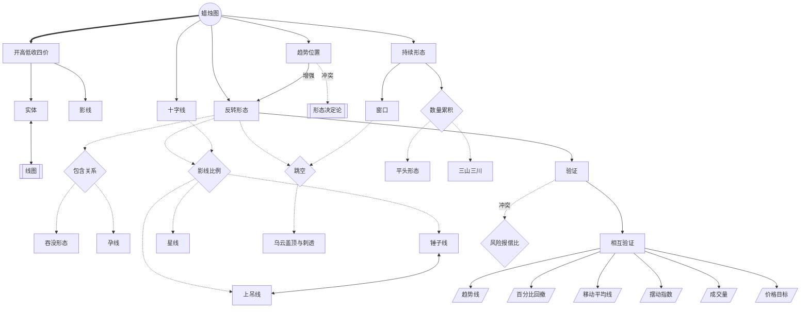

<!-- 内容属性：AI 辅助生成的知识蒸馏成果，非原书替代品。知识截止 2026-10。原书：《日本蜡烛图技术（第2版）》，史蒂夫·尼森著，丁圣元译。 -->

# 《日本蜡烛图技术（第2版）》蒸馏稿 · D5 图谱 · M 档

**古老东方投资术的现代指南** ｜ 史蒂夫·尼森（Steve Nison） 著 · 丁圣元 译

## 〇、内容属性声明

- **AI 生成属性**：本稿由 AI 辅助生成，是对原书概念体系的结构化整理，不构成原书替代品。
- **知识截止**：2026-10。原书为 2004 年第二版中译本。
- **版权说明**：本稿不含原书连续正文；术语定义均为改写，不摘录原文段落。原书著作权归作者与出版方所有。
- **引用规则**：每个术语均标「第X章·p.N」锚点，可回查首次出现位置；蒸馏者补充的判断单独标注。

## 一、蒸馏契约卡

| 字段 | 取值 |
|---|---|
| 蒸馏形态 | D5 概念图谱（Mermaid 图谱 + 术语词典 + 关系矩阵） |
| 深度档位 | M 标准蒸馏 |
| 目标读者 | 已读完一遍、但概念之间关系仍散乱的读者 |
| 复用场景 | 术语对齐、判读口径统一、教学备课 |
| 原书可得性 | 全文可得：407 页，含 302 张插图 |
| 节点规模 | 32 个概念节点、35 条关系边、32 条词典条目（节点数 == 词典条目数） |
| 骨架类型 | 体系型（教材 · 工具书）：一个根概念向下分叉出判据与形态，再向西方工具借目标 |

## 二、正文主体

### 概念骨架

**骨架类型**：体系型（教材 · 工具书）。根概念只有一个，其余全部挂在下游。

**判定依据**：全书没有并列的独立论点，所有概念都从「蜡烛图」这一根向下分叉：先分出入与出的四价，再分出形状判据，再分出形态家族，最后向西方工具借价格目标。骨架因此是一棵树，不是一张网。

- 蜡烛图不新增数据，只把线图丢弃的影线维度重新编码（第1章·p.24–30）
- 四价派生实体与影线，影线比例构成第一条判据（第3章·p.49–52）
- 趋势位置决定同一形状的叫法与方向，是全部形态判读的前置条件（第4章·p.62–64）
- 反转形态往下只由两条判据分叉：包含关系与影线比例（第4章·p.73、p.64）
- 跳空把反转形态扩展到双根与三根组合，并独立成为持续形态的边界判据（第5章·p.102、第7章 p.192）
- 数量累积是第五个维度，负责衡量持续性与衰竭（第6章·p.155）
- 验证是形态与交易之间的唯一闸门，未经确认的形态不产生动作（第4章·p.68）
- 相互验证把蜡烛图与六类西方工具连成一张网，网络越密伪信号越少（第10章·p.259）
- 蜡烛图不产出价格目标，目标必须来自西方工具（第16章·p.335）
- 验证的等待与风险报偿比之间存在结构性冲突，作者未给出量化解法（第4章·p.66–68）

### 概念图谱

读图顺序：从下往上。形态家族挂在判据上，判据挂在根概念上——所以任何一个形态名都能反推到它由哪条判据定义。

**图例**：双圆＝根概念，方框＝核心或派生概念，六边形＝判据，平行四边形＝工具，双框＝反概念；实线箭头＝依赖，虚线箭头＝派生，粗箭头＝构成，双向箭头＝对立，带标签的箭头＝增强或冲突。

### 术语词典

「作者特有用法」一列用于区分「这个词在通常语境里是什么意思」与「它在这本书的体系里是什么意思」。这一列空着，词典就退化成普通词表。

| 编号 | 术语 | 类型 | 定义 | 首次出现 | 作者特有用法 | 节点 ID |
|---|---|---|---|---|---|---|
| T01 | 蜡烛图 | 根概念 | 用开市、最高、最低、收市四个价格绘制的K线图，实体记净战果、影线记试探幅度 | 第3章·p.49 | 它是同一份价格数据的另一种画法，不是新指标 | ROOT |
| T02 | 开高低收四价 | 核心概念 | 每个时段内的四个成交价：开盘、最高、最低、收盘 | 第3章·p.50 | 影线所依赖的原始数据；线图只取其中的收市价 | C1 |
| T03 | 实体 | 核心概念 | 开盘价与收盘价之间的矩形，长度即多空净战果 | 第3章·p.51 | 作者以实体的颜色与长短判断谁在控盘 | C2 |
| T04 | 影线 | 核心概念 | 实体之外延伸到最高价或最低价的细线 | 第3章·p.51 | 全书优势的来源；线图完全丢弃这一维度 | C3 |
| T05 | 趋势位置 | 核心概念 | 形态出现之前那段行情的方向与所处阶段 | 第4章·p.62 | 作者把位置置于形状之上，同形不同义由此而来 | C4 |
| T06 | 反转形态 | 核心概念 | 提示趋势状态可能改变的蜡烛图组合 | 第4章·p.58 | 作者明确它不等于必然反向，更准确的名字是趋势变化形态 | C5 |
| T07 | 持续形态 | 核心概念 | 提示原趋势将继续的蜡烛图组合 | 第7章·p.191 | 判据是边界未被关闭，而不是形态长得像 | C6 |
| T08 | 十字线 | 核心概念 | 开盘价与收盘价相同的蜡烛线，实体退化为一条横线 | 第8章·p.229 | 只在顶部有效，在底部多数无效 | C7 |
| T09 | 验证 | 判据 | 形态出现后由后续时段的价格行为确认其成立 | 第4章·p.68 | 作者把形态与验证严格分开：形态提供嫌疑，验证才定罪 | C8 |
| T10 | 相互验证 | 方法 | 同一价位或邻近价位上出现多个彼此独立的技术信号 | 第10章·p.259 | 血缘越远的方法同时报警，信息重叠越少 | C9 |
| T11 | 窗口 | 派生概念 | 两根K线影线之间未成交的真空区，即跳空 | 第7章·p.192 | 实体之间的空白不算窗口，只有影线不重叠才算 | C10 |
| T12 | 包含关系 | 判据 | 后一根实体完全覆盖或完全被前一根实体覆盖 | 第4章·p.73 | 吞没与孕线共用此判据，方向相反即为两种形态 | K1 |
| T13 | 影线比例 | 判据 | 影线长度与实体长度的比值，以及影线的朝向 | 第4章·p.64 | 两倍是作者给出的硬门槛，不是经验值 | K2 |
| T14 | 跳空 | 判据 | 相邻两根K线的价格区间不连续 | 第5章·p.102 | 作者区分影线跳空与实体空白，只认前者 | K3 |
| T15 | 数量累积 | 判据 | 同向形态重复出现的次数，以及每次幅度的递减 | 第6章·p.155 | 次数衡量持续性，幅度递减衡量衰竭 | K4 |
| T16 | 锤子线 | 派生概念 | 下跌之后出现的伞形线：实体在上、长下影、无上影 | 第4章·p.64 | 作者要求下影不短于实体两倍，且必须紧接跌势 | PA |
| T17 | 上吊线 | 派生概念 | 上涨之后出现的伞形线，形状与锤子线完全相同 | 第4章·p.68 | 同名不同义的关键样本，须次日收市跌破实体才成立 | PB |
| T18 | 吞没形态 | 派生概念 | 第二根实体完全覆盖第一根实体，且两实体颜色相反 | 第4章·p.73 | 第一根为十字线时颜色条件可豁免 | PC |
| T19 | 乌云盖顶与刺透 | 派生概念 | 顶部与底部互为镜像的两根K线深度反转形态 | 第4章·p.84 | 作者对底部（刺透）的要求比顶部严格，中点不可让步 | PD |
| T20 | 星线 | 派生概念 | 小实体与前一根大实体不重叠的K线 | 第5章·p.99 | 判据是不重叠而不是跳空；跳空只提高强度 | PE |
| T21 | 孕线 | 派生概念 | 第一根大实体完全包含第二根小实体 | 第6章·p.127 | 与吞没顺序相反；第二根越小越强，十字孕线为极值 | PF |
| T22 | 平头形态 | 派生概念 | 相邻两根K线的高点或低点齐平 | 第6章·p.134 | 价值在价位不在形状，它把阻挡收敛成一个可下单的点 | PG |
| T23 | 三山三川 | 派生概念 | 三次冲高或探低形成的顶部与底部结构 | 第6章·p.164 | 级别高于单根形态，但仍须末端蜡烛图信号确认 | PH |
| T24 | 趋势线 | 工具 | 连接两个以上高点或低点的直线 | 第11章·p.268 | 作者只把它当候选边界，须由线上的蜡烛图信号确认 | M1 |
| T25 | 百分比回撤 | 工具 | 38.2% / 50% / 61.8% 三个回调落点 | 第12章·p.292 | 作者把它当市场习惯的犹豫处，不是数学定律 | M2 |
| T26 | 移动平均线 | 工具 | 收市价的滚动平均值，可充当支撑或阻挡 | 第13章·p.296 | 它给趋势背景，不给入场信号 | M3 |
| T27 | 摆动指数 | 工具 | RSI、随机指数等衡量超买超卖的振荡指标 | 第14章·p.307 | 与价格的背离比指标数值本身重要 | M4 |
| T28 | 成交量 | 工具 | 时段内的成交数量，用于确认价格运动 | 第15章·p.327 | 胀爆（巨量长阳长阴）标记某一方的集中投降 | M5 |
| T29 | 价格目标 | 工具 | 由箱体、对等运动、旗形、三角形测算出的幅度 | 第16章·p.335 | 蜡烛图不提供它，必须向西方工具外借 | M6 |
| T30 | 线图 | 反概念 | 只连接各时段收市价的折线图 | 第1章·p.30 | 作者以它为对照物：丢弃影线即丢弃盘中博弈痕迹 | N1 |
| T31 | 形态决定论 | 反概念 | 认为某种图形必然导致某种结果的看法 | 第4章·p.59 | 作者通篇反对；反转形态只提示趋势可能变化 | N2 |
| T32 | 风险报偿比 | 判据 | 潜在收益与潜在亏损的比值 | 第4章·p.66 | 作者要求先算比例再决定是否入场，顺序不可颠倒 | QS |

### 关系矩阵（枢纽节点局部）

只列七个枢纽概念。行依赖列，✓ 表示存在关系，破折号表示无直接关系。

| 行依赖列 → | 趋势位置 | 反转形态 | 验证 | 相互验证 | 风险报偿比 | 价格目标 | 持续形态 |
|---|---|---|---|---|---|---|---|
| **趋势位置** | — | ✓ 决定同形异义 | — | — | — | — | ✓ 决定形态归属 |
| **反转形态** | 依赖 | — | ✓ 须经确认 | — | — | — | — |
| **验证** | — | 依赖 | — | ✓ 升级为汇聚 | ✓ 影响比例 | — | — |
| **相互验证** | — | — | 依赖 | — | — | — | — |
| **风险报偿比** | — | — | 冲突 | — | — | — | — |
| **价格目标** | — | — | — | 依赖 | ✓ 决定盈亏比 | — | — |
| **持续形态** | 依赖 | — | — | — | — | — | — |

### 用法

| 字段 | 内容 |
|---|---|
| **触发** | 看到任何一个陌生形态，或对某个形态的叫法拿不准时 |
| **动作** | 在图谱上先定位它挂在哪条判据分支，再回查术语词典的定义与作者特有用法 |
| **时长** | 单次定位 60 秒以内；一个交易日累计不超过 10 分钟 |
| **验收** | 能说出该形态属于哪条判据、与哪个形态互为镜像、在哪一章首次出现 |
| **复现** | 换一个人按同一条分支走一遍，落到同一个节点即为通过 |

> **蒸馏者按语**：概率意义上的早与风险意义上的好不可兼得：等验证则端点远离、比例恶化；不等验证则比例好、伪信号多。两条要求都被反复申说，却没有给出量化折中方案——这是原书留下的空白，不是误读。补充一条边界：在强趋势条件下，形态的失效概率通常高于震荡市；仅适用于震荡市的形态（平头、孕线、两只乌鸦）往往在单边市连续给错，此时应以趋势方向为准，不适用逆势判读。

## 三、命题表

与 D1 精华共用同一套命题基线，锚点一致，便于跨文件对齐。四层权重：L1 骨架 1.0 / L2 论证链 0.7 / L3 支撑论据 0.3。

| 编号 | 命题内容 | 层级 | 权重 | 锚点 | 来源 |
|---|---|---|---|---|---|
| P001 | 蜡烛图把开市、最高、最低、收市四价编码为一根图线；实体记录多空净战果，影线记录盘中试探的失败幅度。 | L1 | 1.0 | 第3章·p.49–52 | 原书 |
| P002 | 同一形状在不同趋势位置含义相反：锤子与上吊、流星与倒锤子、北方与南方十字线都是同一形状的两副面孔。 | L1 | 1.0 | 第4章·p.62–64 | 原书 |
| P003 | 「反转形态」的准确含义是「趋势变化形态」；据此开新仓须与主趋势同向，逆主趋势的信号只用于了结旧仓。 | L1 | 1.0 | 第4章·p.58–61 | 原书 |
| P004 | 锤子线三条硬标准：实体在上端、下影线不短于实体两倍、无上影线或极短；上吊线还须次日收市跌破其实体。 | L1 | 1.0 | 第4章·p.64–72 | 原书 |
| P005 | 吞没形态三条标准：有明确前趋势、第二实体完全覆盖第一实体、两实体颜色相反（第一根为十字线时例外）。 | L1 | 1.0 | 第4章·p.73–75 | 原书 |
| P006 | 乌云盖顶与刺透形态共用一条深度判据：第二根收市须扎入第一根实体中点以上或以下，此条无灵活余地。 | L1 | 1.0 | 第4章·p.84–91 | 原书 |
| P007 | 星线的判据是两个实体不重叠；实体越小、僵持越彻底，原趋势驱动力瓦解的证据越强。 | L1 | 1.0 | 第5章·p.99–101 | 原书 |
| P008 | 启明星与黄昏星的决定性因素是第三根深入第一根实体的深度；第二三根之间是否跳空不是必要条件。 | L1 | 1.0 | 第5章·p.102–108 | 原书 |
| P009 | 弃婴形态要求十字线前后两次跳空、影线互不接触，是黄昏星与启明星的极端特例，出现频率极低。 | L1 | 1.0 | 第5章·p.113–115 | 原书 |
| P010 | 孕线与吞没的包含顺序相反，第二根实体越小越强，十字孕线为其极值。 | L1 | 1.0 | 第6章·p.127–129 | 原书 |
| P011 | 平头形态的价值在价位而非形状：它把支撑或阻挡从一条模糊的带收敛成一个可下单的点。 | L1 | 1.0 | 第6章·p.134–142 | 原书 |
| P012 | 白三兵之后的整理，其落点常在率先出现的第一或第二根白线范围内形成支撑。 | L1 | 1.0 | 第6章·p.160–162 | 原书 |
| P013 | 前方受阻与停顿形态只用于了结多头或加保护，不可据以开立空头。 | L1 | 1.0 | 第6章·p.159 | 原书 |
| P014 | 三山、三川、三尊、倒三尊属主要反转形态，级别高于单根或双根K线形态，但须由末端蜡烛图信号确认。 | L1 | 1.0 | 第6章·p.164–169 | 原书 |
| P015 | 窗口的判据是影线之间不重叠，实体之间的空白不算窗口；窗口的全部空间构成支撑或阻挡。 | L1 | 1.0 | 第7章·p.192–194 | 原书 |
| P016 | 只要最后一个同向窗口未被收市价关闭，趋势就依然有效；「三个窗口后趋势将尽」的说法不成立。 | L1 | 1.0 | 第7章·p.200 | 原书 |
| P017 | 形态出现的位置比形态本身更重要：同样的看涨形态长在阻挡位下方，不构成买点。 | L1 | 1.0 | 第7章·p.221–227 | 原书 |
| P018 | 十字线揭示顶部远比揭示底部有效，因为下跌不需要买盘，上涨必须有买盘。 | L1 | 1.0 | 第8章·p.233–234 | 原书 |
| P019 | 十字线只有在「有趋势可反转」时才有意义；箱体中部出现的十字线不构成信号。 | L1 | 1.0 | 第8章·p.244 | 原书 |
| P020 | 同一张图上可以同时标注出三十八个信号，说明信号之间是重叠关系而非互斥关系。 | L1 | 1.0 | 第9章·p.252–258 | 原书 |
| P021 | 相互验证＝在同一价位或邻近价位出现一群彼此独立的技术信号；汇聚度越高，反转概率越大。 | L1 | 1.0 | 第10章·p.259 | 原书 |
| P022 | 极性转换原则：被有效突破的支撑转为阻挡，被突破的阻挡转为支撑；前提是该水平此前经过多次验证。 | L1 | 1.0 | 第11章·p.284–290 | 原书 |
| P023 | 破低反涨与破高反跌：价格短暂越过前一个边界又迅速收回，是边界失效的反向证据。 | L1 | 1.0 | 第11章·p.276–283 | 原书 |
| P024 | 百分比回撤位只提供候选落点，须由该位置上的蜡烛图信号确认才算成立。 | L1 | 1.0 | 第12章·p.292–295 | 原书 |
| P025 | 移动平均线可以充当支撑或阻挡，但它给的是趋势背景，不是入场信号。 | L1 | 1.0 | 第13章·p.296–306 | 原书 |
| P026 | 价格与摆动指数的背离，是趋势动能衰竭的独立证据，可先于价格本身发出警告。 | L1 | 1.0 | 第14章·p.313–320 | 原书 |
| P027 | 胀爆（巨量长阳或长阴）标记的是多空某一方的集中投降，通常出现在趋势的末段。 | L1 | 1.0 | 第15章·p.327–331 | 原书 |
| P028 | 蜡烛图提供早期反转信号但不提供价格目标；幅度问题必须交给箱体、对等运动、旗形与三角形。 | L1 | 1.0 | 第16章·p.335 | 原书 |
| P029 | 风险报偿比必须先于信号：形态完成时价格常已远离端点，此时追进的比例可能已经不可接受。 | L1 | 1.0 | 第16章·p.335、第4章 p.66 | 原书 |
| P030 | 任何技术信号都必须预设「证明我错了」的价位；没有这个价位，就不是交易，是赌。 | L1 | 1.0 | 第4章·p.67–68 | 原书 |
| P031 | 蜡烛图没有新增任何数据，只是把线图丢弃的影线维度重新编码，因此基于四价的西方工具都能叠加。 | L1 | 1.0 | 第1章·p.24–30 | 原书 |
| P032 | 多类工具在同一价格区域先后报警时，单点判读的误差被大幅抵消，这是相互验证的极限形态。 | L1 | 1.0 | 第17章·p.351–353 | 原书 |
| P033 | 形态名称取自战争与日常语汇（三兵、乌鸦、弃婴、上吊），命名本身不含判据，不能望文生义。 | L2 | 0.7 | 第2章·p.43–47 | 原书 |
| P034 | 与线图对照：同一组价格数据，线图只保留收市价，蜡烛图保留四个价位与盘中路径。 | L2 | 0.7 | 第1章·p.30 | 原书 |
| P035 | 星线之间是否跳空不是必要条件，实体不重叠才是；跳空只提高强度，不改变类别。 | L2 | 0.7 | 第5章·p.104 | 原书 |
| P036 | 白三兵若每根实体的推进幅度依次缩短，说明买盘衰竭，形态降级为前方受阻。 | L2 | 0.7 | 第6章·p.150 | 原书 |
| P037 | 捉腰带线的判据是开盘即最低或最高，实体越长越有效；短实体版本不具备同等强度。 | L2 | 0.7 | 第6章·p.170 | 原书 |
| P038 | 窗口被回补后立即转为反向边界；回补的深度决定趋势是延续还是终结。 | L2 | 0.7 | 第7章·p.196 | 原书 |
| P039 | 长白线之后出现十字线时，取两者最高的高点作为阻挡，以收市价判定是否突破。 | L2 | 0.7 | 第8章·p.238 | 原书 |
| P040 | 趋势线本身只是候选边界，须由落在该线上的蜡烛图信号确认；未经确认的趋势线不构成交易依据。 | L2 | 0.7 | 第11章·p.272 | 原书 |
| P041 | 支撑与阻挡的有效性由被触及次数与被突破后的收回速度共同决定，单次触及不构成验证。 | L2 | 0.7 | 第11章·p.280 | 原书 |
| P042 | 均线构成支撑的前提是足够多的参与者使用同一参数；参数被普遍改用后，该支撑自行消失。 | L2 | 0.7 | 第13章·p.300 | 原书 |
| P043 | 振荡指标在超买区钝化时，蜡烛图的反转信号比指标交叉更早，两者互为补充而非替代。 | L2 | 0.7 | 第14章·p.315 | 原书 |
| P044 | 对等运动把第一波高度叠加到回调低点，给出最小价格目标；目标位仍须蜡烛图信号扣动扳机。 | L2 | 0.7 | 第16章·p.340 | 原书 |
| P045 | 沃尔玛锤子线案例：收市追进者次日被套，等回落至下影线区间者风险极小——同一根K线两种结局。 | L3 | 0.3 | 第4章·p.66–68 | 原书 |
| P046 | 微软日线三只乌鸦之后的连续下跌，是三根同向实体逐级压低的典型样本。 | L3 | 0.3 | 第6章·p.176 | 原书 |
| P047 | 思科向上的窗口长期未被收市回补，趋势延续数月，印证窗口即边界的判据。 | L3 | 0.3 | 第7章·p.211 | 原书 |
| P048 | 小麦期货案例：蜡烛图先于摆动指数发出顶部警告，是灵敏度优势的直接证据。 | L3 | 0.3 | 第14章·p.323 | 原书 |
| P049 | 38.2% 回撤位上的刺透形态，是回撤位与蜡烛图信号叠加确认的样本。 | L3 | 0.3 | 第12章·p.293 | 原书 |

## 四、还原索引

命题编号 → 本图谱中的落点 → 原书锚点。图谱节点与命题的对应关系可按此表双向回查。

| 命题编号 | 图谱节点 | 原书锚点 |
|---|---|---|
| P001 | 四价层 | 第3章·p.49–52 |
| P002 | 判据层 | 第4章·p.62–64 |
| P003 | 判据层 | 第4章·p.58–61 |
| P004 | 判据层 | 第4章·p.64–72 |
| P005 | 判据层 | 第4章·p.73–75 |
| P006 | 判据层 | 第4章·p.84–91 |
| P007 | 形态层 | 第5章·p.99–101 |
| P008 | 形态层 | 第5章·p.102–108 |
| P009 | 形态层 | 第5章·p.113–115 |
| P010 | 形态层 | 第6章·p.127–129 |
| P011 | 形态层 | 第6章·p.134–142 |
| P012 | 形态层 | 第6章·p.160–162 |
| P013 | 形态层 | 第6章·p.159 |
| P014 | 形态层 | 第6章·p.164–169 |
| P015 | 持续层 | 第7章·p.192–194 |
| P016 | 持续层 | 第7章·p.200 |
| P017 | 持续层 | 第7章·p.221–227 |
| P018 | 十字线层 | 第8章·p.233–234 |
| P019 | 十字线层 | 第8章·p.244 |
| P020 | 应用层 | 第9章·p.252–258 |
| P021 | 应用层 | 第10章·p.259 |
| P022 | 应用层 | 第11章·p.284–290 |
| P023 | 应用层 | 第11章·p.276–283 |
| P024 | 应用层 | 第12章·p.292–295 |
| P025 | 应用层 | 第13章·p.296–306 |
| P026 | 应用层 | 第14章·p.313–320 |
| P027 | 应用层 | 第15章·p.327–331 |
| P028 | 应用层 | 第16章·p.335 |
| P029 | 应用层 | 第16章·p.335、第4章 p.66 |
| P030 | 判据层 | 第4章·p.67–68 |
| P031 | 根概念层 | 第1章·p.24–30 |
| P032 | 应用层 | 第17章·p.351–353 |
| P033 | 根概念层 | 第2章·p.43–47 |
| P034 | 根概念层 | 第1章·p.30 |
| P035 | 形态层 | 第5章·p.104 |
| P036 | 形态层 | 第6章·p.150 |
| P037 | 形态层 | 第6章·p.170 |
| P038 | 持续层 | 第7章·p.196 |
| P039 | 十字线层 | 第8章·p.238 |
| P040 | 应用层 | 第11章·p.272 |
| P041 | 应用层 | 第11章·p.280 |
| P042 | 应用层 | 第13章·p.300 |
| P043 | 应用层 | 第14章·p.315 |
| P044 | 应用层 | 第16章·p.340 |
| P045 | 判据层 | 第4章·p.66–68 |
| P046 | 形态层 | 第6章·p.176 |
| P047 | 持续层 | 第7章·p.211 |
| P048 | 应用层 | 第14章·p.323 |
| P049 | 应用层 | 第12章·p.293 |

## 五、剔除台账

与 D1 精华共用同一份台账，确保两个文件对原书的删减口径一致。

| 编号 | 被删内容摘要 | 冗余类型 | 删除理由 | 原书锚点 | 可挽回性 |
|---|---|---|---|---|---|
| X-001 | 「反转形态意味着趋势可能变化而非必然反转」在第四、六章与结语共出现 4 次 | R1 | 与 P003 同构，保留第四章的刹车灯比喻（表述最完整），其余归并 | 第4章·p.58、第6章 p.126 | 可读回原文 |
| X-002 | 「蜡烛图不提供价格目标」在第九、十六章与结语重复 3 次 | R1 | 与 P028 同构，保留第十六章的完整论述 | 第9章·p.258、第16章 p.335 | 可读回原文 |
| X-003 | 每个形态配 2–6 个真实市场案例：沃尔玛、微软、思科、朗讯、英特尔、康宁等，合计约 215 张截图 | R2 | 同构案例只留最佳一例的方法论要点，其余按图号登记，可在 figures/ 目录中按图号检索 | 全书 | 已登记论据索引 |
| X-004 | 「瞧，这个名称有多拗口」「肯定有人会觉得饿了」「我的儿子埃文说……」等轶事与插科打诨约 30 处 | R3 | 不承载判据，删除后不影响任何一条命题；保留「咬人的狗不叫唤」等承载语义的谚语 | 第1章·p.7、第6章 p.150 | 可读回原文 |
| X-005 | 第二章历史背景：堂岛米市、本间宗久、酒田战法的源流叙述 | R4 | 压缩为一句背景说明，不进入骨架；对形态判读不产生操作影响 | 第2章·p.43–47 | 要点已保留 |
| X-006 | 译者序中关于 1997 年宏观形势、个人履历的段落 | R4 | 与时序判读无关；保留其中信息量与血缘关系远近的技术论证，这是相互验证原则的最佳注解 | 前言·p.9–19 | 可读回原文 |
| X-007 | 作者对第一版销量、被译成六种语言、被称为圣经的自述，以及网站推广段落 | R5 | 自我指涉，无信息增量 | 第1章·p.7、p.24 | 可读回原文 |
| X-008 | 约 215 张同一形态的重复案例截图（不同股票、不同年代） | R2 | 示意图与关键案例图保留，重复案例按图号留在 figures/ 目录，可随时调回 | 全书 | 已登记论据索引 |

## 六、复核清单

1. 能否说出图谱里哪三个节点是判据？它们分别定义哪些形态？
2. 锤子线与上吊线在图上是同一条边连出去的吗？为什么它们是对立关系？
3. 从「反转形态」出发，能否只沿箭头走到「价格目标」？如果走不到，缺的是哪一步？
4. 词典里哪几条的「作者特有用法」与日常理解差别最大？
5. 图谱中标注为冲突的那条边，原书是否给出了解决方案？

---

本蒸馏稿可一键导出为 PDF / Word / HTML 等主流格式。
